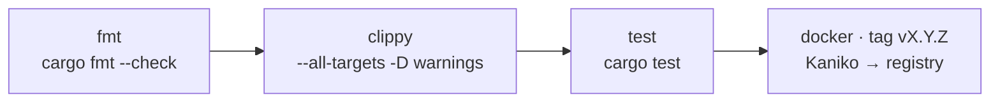

<h1 align="center">kraken-hub</h1>

<p align="center">
  A stateless gRPC router for commands and queries between kraken services, in the spirit of Axon Server.
</p>

<p align="center">
  <a href="https://gitlab.damoreira.ml/kraken-org/kraken-hub/-/pipelines"></a>
  <a href="https://gitlab.damoreira.ml/kraken-org/kraken-hub/-/releases"></a>
  
  
  
  <a href="https://gitlab.damoreira.ml/kraken-org/kraken/-/tree/main/docs"></a>
  <a href="LICENSE"></a>
</p>

---

Axon-Server-like gRPC router for kraken. Services open one bidirectional stream (`Hub.Connect`),
register the command and query types they handle, and the hub forwards each request to a live
instance of the owning service and relays the reply. Events never pass through here; they go
straight to Kafka.

Design and protocol: see the umbrella docs `../kraken/docs/05-services/hub.md` and
`../kraken/docs/02-messaging.md`. The proto in `proto/hub.proto` is a copy of
`../kraken/protocol/hub.proto` (see `proto/README.md`). Items marked **Builder call** below are
implementation decisions that are not yet in the umbrella spec; the spec is updated separately.

## Table of contents

- [Build and test](#build-and-test)
- [Running locally](#running-locally)
- [Topology view](#topology-view)
- [Dashboard](#dashboard)
- [Security](#security)
- [Protocol summary](#protocol-summary)
- [Routing and limitations](#routing-and-limitations)
- [Connection lifecycle](#connection-lifecycle)
- [Observability](#observability)
- [Image](#image)
- [Layout](#layout)
- [CI/CD pipeline](#cicd-pipeline)
- [Contributing](#contributing)
- [License](#license)

## Build and test

Requires Rust 1.99.1 (`rust-toolchain.toml` pins it) and `protoc`. `cmake` is not needed.

```sh
cargo build
cargo test
cargo clippy --all-targets -- -D warnings
cargo fmt --check
```

Unit tests live next to the code in `src/`; integration tests in `tests/` start a real hub on an
ephemeral port and drive it over gRPC.

## Running locally

```sh
cargo run
```

| Variable | Default | Meaning |
|---|---|---|
| `KRAKEN_HUB_ID` | hostname + `-` + 8 random hex digits | identifies this hub process in `RegisterAck.hub_id` and the topology (`hubId`) |
| `KRAKEN_HUB_LISTEN` | `0.0.0.0:7000` | gRPC bind address |
| `KRAKEN_HUB_HTTP_LISTEN` | `0.0.0.0:7001` | HTTP bind address for `GET /topology`, the dashboard and its API; empty disables the HTTP listener |
| `KRAKEN_HUB_OTLP_ENDPOINT` | `http://otel-lgtm:4317` | OTLP gRPC endpoint for traces and metrics |
| `KRAKEN_HUB_LOG` | `info` | `tracing` filter, for example `kraken_hub=debug,info` |
| `KRAKEN_HUB_DEFAULT_TIMEOUT_MS` | `5000` | used when `Request.timeout_ms` is 0 and the type has no override |
| `KRAKEN_HUB_MAX_TIMEOUT_MS` | `60000` | upper clamp for `Request.timeout_ms` on types without an override |
| `KRAKEN_HUB_TIMEOUT_OVERRIDES` | none | per-type timeouts, `type=ms,type=ms` (for example `files.Upload=120000`); see [Request timeouts](#request-timeouts) |
| `KRAKEN_HUB_HEARTBEAT_INTERVAL` | `3s` | heartbeat period announced to v2 clients in `RegisterAck`; `KRAKEN_HUB_HEARTBEAT_TIMEOUT` must be at least twice it |
| `KRAKEN_HUB_HEARTBEAT_TIMEOUT` | `10s` | dead-instance threshold for v2 sessions (`10`, `10s` or `500ms`) |
| `KRAKEN_HUB_LEGACY_HEARTBEAT_TIMEOUT` | `30s` | dead-instance threshold for v1 sessions (`Register.protocol_version` 0, clients that heartbeat every 10 s) |
| `KRAKEN_HUB_QUEUE_CAPACITY_PER_INSTANCE` | `10000` | requests queued for one flow-controlled instance before new ones are rejected |
| `KRAKEN_HUB_QUEUE_BYTES_PER_INSTANCE` | `64MiB` | encoded bytes queued for one flow-controlled instance before new requests are rejected (`B`, `KiB`, `MiB`, `GiB`, or plain bytes) |
| `KRAKEN_HUB_QUEUE_BYTES_TOTAL` | `512MiB` | encoded bytes queued over all flow-controlled instances together before new requests are rejected (reason `queue_bytes_total`; same units) |
| `KRAKEN_HUB_OWNER_GRACE` | `60s` | keep type ownership after the last instance leaves |
| `KRAKEN_HUB_MAX_STREAM_DURATION` | `10m` | a [streaming query](#query-modes) open for longer ends with `ReplyEnd{error = CANCELLED}` and its handler is cancelled; at least `1s` |
| `KRAKEN_HUB_SUBSCRIPTION_BUFFER` | `256` | updates of a [subscription](#query-modes) the hub holds while its sender owes credit; one more ends it with `ReplyEnd{error = RESOURCE_EXHAUSTED}`; positive |
| `KRAKEN_HUB_MAX_SUBSCRIPTIONS_PER_INSTANCE` | `1024` | subscription targets one handler instance serves at once; a subscription that would exceed it on any target is refused with `Error{RESOURCE_EXHAUSTED}` before anything is sent; positive |
| `KRAKEN_HUB_MAX_SUBSCRIPTION_DURATION` | `0` | a subscription open for longer ends with `ReplyEnd{error = CANCELLED}` and its targets are cancelled; `0` is unlimited, otherwise at least `1s` |
| `KRAKEN_HUB_SESSION_BUFFER` | `1024` | per-session outbound buffer, in messages |
| `KRAKEN_HUB_HANDSHAKE_TIMEOUT` | `10s` | a new `Connect` stream must send `Register` within this (`10`, `10s` or `500ms`) |
| `KRAKEN_HUB_DASHBOARD_ENABLED` | `true` | serve the read-only dashboard (`/ui/`) and its API (`/api/v1/`) on the HTTP port and keep the edge statistics; `false` makes them 404 (`true`/`false`, `1`/`0`, `yes`/`no`, `on`/`off`) |
| `KRAKEN_HUB_GRAFANA_URL` | none | Grafana base URL the dashboard links to; must be `http://` or `https://` without user info (`user:password@` is rejected at startup, as the link is served unauthenticated) |
| `KRAKEN_HUB_EDGE_STATS_MAX_EDGES` | `10000` | cap on `(sender service, type)` edges kept for the dashboard graph; at the cap the least recently used go first |
| `KRAKEN_HUB_EDGE_STATS_WINDOW` | `5m` | sliding window of the edge statistics, at least `10s` |
| `KRAKEN_HUB_PEERS` | none | the other hubs' dashboard base URLs as the operator's browser reaches them, comma-separated, for example `http://localhost:7001,http://localhost:7011` (this hub's own URL may be listed; the page skips it by hub id). Each must be `http://` or `https://` with a host and optional port, no user info, no path beyond `/`; normalised to origins (lowercase, default port dropped), duplicates removed, at most 16; anything else stops the hub at startup. See [Multiple hubs](#multiple-hubs) |

| `KRAKEN_HUB_AUTH_MODE` | `off` | `off`, `permissive` (evaluate every rule, log and count violations, allow everything) or `enforce` (refuse them); anything but `off` needs `KRAKEN_HUB_ACL_FILE`. See [Security](#security) |
| `KRAKEN_HUB_ACL_FILE` | none | TOML ACL: SHA-256 of each static token to its service, `handle` and `send` patterns; reloaded when it changes |
| `KRAKEN_HUB_RELOAD_INTERVAL` | `5s` | how often the ACL and the TLS pairs are checked for changes; SIGHUP reloads at once |
| `KRAKEN_HUB_TLS_CERT`, `KRAKEN_HUB_TLS_KEY` | none | PEM pair of the gRPC listener, both or neither; the listener then accepts TLS only |
| `KRAKEN_HUB_HTTP_TLS_CERT`, `KRAKEN_HUB_HTTP_TLS_KEY` | the gRPC pair | PEM pair of the HTTP listener |
| `KRAKEN_HUB_DASHBOARD_TOKEN` | none | at least 16 characters; when set `/topology`, `/api/v1/*` and the gRPC `Topology` call need `Authorization: Bearer <token>` |
| `KRAKEN_HUB_DASHBOARD_WRITE_TOKEN` | none | reserved for the processor controls of roadmap P6; parsed, unused |

Durations accept `30` (seconds), `30s`, `500ms` and `5m`.

The topology view (`GET /topology`, `kraken-hub --topology`) is described in [Topology view](#topology-view),
the dashboard in [Dashboard](#dashboard).

- **Builder call:** `KRAKEN_HUB_OTLP_ENDPOINT` defaults to `http://otel-lgtm:4317`. Leaving it
  unset keeps that default; setting it to an empty string disables OTLP export, which is useful
  for `cargo run` without a collector. (For every other variable an empty value means "unset".)
- **Builder call:** `KRAKEN_HUB_HANDSHAKE_TIMEOUT` (default `10s`): a stream that sends nothing,
  or no `Register`, within it is closed with `DEADLINE_EXCEEDED` `no Register within 10s`. A
  `Register` with an empty `instance_id` or `service_name` is closed with `INVALID_ARGUMENT`.
- Startup fails on a malformed `KRAKEN_HUB_TIMEOUT_OVERRIDES` (entry without `=`, empty type,
  non-numeric, zero or above `u32::MAX` milliseconds, a type listed twice) and when
  `KRAKEN_HUB_HEARTBEAT_TIMEOUT` is less than twice `KRAKEN_HUB_HEARTBEAT_INTERVAL` (one late
  heartbeat would evict). A `KRAKEN_HUB_LEGACY_HEARTBEAT_TIMEOUT` below 20 s is accepted with a
  startup warning: v1 clients heartbeat every 10 s.
- **Builder call:** on macOS, port 7000 is held by Control Center (AirPlay Receiver). Either disable
  AirPlay Receiver in System Settings or set `KRAKEN_HUB_LISTEN=0.0.0.0:7002` (7001 is the topology HTTP port; map the compose
  host port accordingly).

## Topology view

The hub can show who is connected right now: every service with its live instances, which command
and query types each instance handles, who owns each type, and how many requests are in flight
(as handler and as sender). It never contains payloads or headers. The same snapshot is served
three ways:

```sh
grpcurl -plaintext -import-path proto -proto hub.proto localhost:7000 kraken.hub.v1.Hub/Topology   # gRPC, same port as Connect
curl localhost:7001/topology                                   # HTTP JSON
kraken-hub --topology [--json]                                 # CLI inside the container
```

```sh
docker exec kraken-hub /app/kraken-hub --topology
docker exec kraken-hub /app/kraken-hub --topology --json
```

- `GET /topology` is served on `KRAKEN_HUB_HTTP_LISTEN` (camelCase fields, `kind` as `COMMAND` or
  `QUERY`), unchanged by the dashboard and served even when the dashboard is disabled. Besides
  the dashboard paths (`/`, `/ui`, `/ui/...`, `/api/v1/...`) every other path is 404.
  **Builder call:** the HTTP endpoint is a second port (7001), because the gRPC port speaks only
  HTTP/2 gRPC. An empty `KRAKEN_HUB_HTTP_LISTEN` disables it.
- `kraken-hub --topology` prints a table (`--json` prints the JSON). It probes `127.0.0.1` on the
  port of `KRAKEN_HUB_LISTEN` (or `--address host:port|https://host:port`) with a 3 s timeout, over
  TLS as `--tls-ca <pem>`, an `https://` address or the environment's TLS setting say, with
  `KRAKEN_HUB_DASHBOARD_TOKEN` from its environment when the hub has one. Exit codes: 0 success, 1 failure (hub
  unreachable or timeout), 2 usage error (unknown or conflicting flags; usage goes to stderr).
  With nothing connected it prints `no services connected` and a totals line.
- Without `KRAKEN_HUB_DASHBOARD_TOKEN` the topology has no authentication, like the rest of the
  port-7000 surface; with it, the gRPC call and `GET /topology` need the token (see [Security](#security)).
- The hub has no gRPC server reflection, hence the `-proto` flags. grpcurl's proto-JSON prints
  int64 as strings and omits default values, so its output differs textually from
  `curl :7001/topology`.

### Snapshot fields

Top level:

| Field | Type | Meaning |
|---|---|---|
| `hubId` | string | `KRAKEN_HUB_ID` |
| `hubStartedAtMs` | int64 | hub start, epoch milliseconds |
| `nowMs` | int64 | snapshot time, epoch milliseconds |
| `heartbeatTimeoutMs` | int64 | the configured `KRAKEN_HUB_HEARTBEAT_TIMEOUT` (v2 sessions), in ms |
| `services` | list | one entry per service with at least one live session |
| `types` | list | one entry per owned type, including orphaned ones |
| `totals` | object | `services`, `instances`, `commandTypes`, `queryTypes`, `inFlight`, `queued` (all counts; `inFlight` includes queued requests) |

`services[]`: `serviceName` (string) and `instances[]`:

| Field | Type | Meaning |
|---|---|---|
| `instanceId` | string | instance id from `Register` |
| `connectedSinceMs` | int64 | when the session started, epoch ms |
| `lastHeartbeatAgeMs` | int64 | time since the last heartbeat, ms |
| `stale` | bool | `lastHeartbeatAgeMs` > a third of this session's own eviction threshold (see below) |
| `inFlightAsHandler` | uint32 | requests currently being handled by this instance |
| `inFlightAsSender` | uint32 | requests this instance sent that have no terminal message yet |
| `commandTypes` | list of string | command types this instance registered |
| `queryTypes` | list of string | query types this instance registered (shared ones included) |
| `sharedQueryTypes` | list of string | the query types it registered as shared (`Register.shared_query_types`) |
| `protocolVersion` | uint32 | `Register.protocol_version` of the session's first `Register` (0 = v1) |
| `clientVersion` | string | `Register.client_version`, for example `kraken-messaging/0.1.0`; empty for v1 clients |
| `flowControlled` | bool | the hub forwards to this instance only with permits |
| `permitsAvailable` | uint32 | permits left (0 when not flow-controlled) |
| `queued` | uint32 | requests waiting in the hub's queue for this instance |
| `loadFactor` | uint32 | `Register.load_factor` as applied (0 reads as 100) |
| `tags` | map | `Register.tags` |
| `connectedHubIds` | list of string | `InstanceStatus.connected_hub_ids` as last reported: the hubs the instance holds a stream to; empty when never reported |
| `statusAgeMs` | int64 | time since that report, ms; `-1` when never reported (also when a JSON snapshot from an older hub lacks the field) |

`types[]`:

| Field | Type | Meaning |
|---|---|---|
| `type` | string | the command or query type name |
| `kind` | string | `COMMAND` or `QUERY` |
| `ownerService` | string | the service that owns the type (the first owner of a shared type) |
| `ownerServices` | list of string | every owning service, sorted (one for an exclusive type) |
| `shared` | bool | a shared query type: many services may own it |
| `liveInstances` | uint32 | live instances of the owner (of all owners) that registered it |
| `orphaned` | bool | the owner has no live instance (ownership is held during the grace period) |
| `orphanedForMs` | int64 | how long it has been orphaned, ms; 0 when not orphaned |

`totals.inFlight` counts requests in the router, so it can differ from the per-instance sums when
a sender or handler is already gone. A scatter-gather counts once in `inFlight` and in its
sender's `inFlightAsSender`, and once per target in each handler's `inFlightAsHandler`.

### Consistency

A snapshot is three sequential reads (sessions, then registry, then router), each under its own
lock and never nested. It is not a single atomic cut: a request or a disconnect can land between
reads. Sessions are the base set: an instance appears only if it has a live session, and its
types and in-flight counts are attached by instance id (empty or zero when absent).

### Staleness

**Builder call:** an instance is `stale` when its last heartbeat is older than a third of its own
eviction threshold (`KRAKEN_HUB_HEARTBEAT_TIMEOUT` for v2 sessions, the legacy timeout for v1).
It is still connected and still receives requests; the flag is an early warning before the hub
evicts it at the full timeout. A brief `stale: true` right before a heartbeat arrives is normal.

### Orphaned types

**Builder call:** when the last instance of a service leaves, its types stay in `types` with
`orphaned: true` and a growing `orphanedForMs` until `KRAKEN_HUB_OWNER_GRACE` expires and the
sweep removes them. Requests for an orphaned type fail with `NO_HANDLER`.

### Register rejections

**Builder call:** two additions to the registry rules.

- A type listed under both `command_types` and `query_types` in one `Register` is rejected with
  `INVALID_ARGUMENT`.
- Registering a type under a different kind than its current owner uses (for example a query
  type that the owner holds as a command) is rejected with `ALREADY_EXISTS`. A type's kind cannot
  change while it is owned; change it only after every instance of the owner has left and the
  owner grace sweep has removed the type.
- Shared query types (`Register.shared_query_types`, umbrella ADR 0017): a type registered
  exclusive by one registrant and shared by another (even of the same service) fails the later
  `Register` with `ALREADY_EXISTS`; a type listed as shared and as a command or exclusive query in
  one `Register` is `INVALID_ARGUMENT`. Like a kind, the flag changes only once the type is gone.

## Dashboard

A read-only web dashboard is compiled into the binary and served on the HTTP port: open
`http://localhost:7001/` (it redirects to `/ui/`). It shows what the topology view shows, plus who
calls whom and how that goes. Decision record: umbrella `docs/adr/0015-embedded-hub-dashboard.md`.

> **Authentication is opt-in.** The dashboard and `/api/v1/` are read-only. Without
> `KRAKEN_HUB_DASHBOARD_TOKEN` they are open to anyone who reaches port 7001, like `GET /topology`:
> keep the port on the private network (the page footer says the same). With the token set the
> page asks for it and every data endpoint needs it; see [Security](#security).

| Page | Shows |
|---|---|
| Overview | totals (services, instances and how many are stale, types, in flight, queued, requests and errors over the window); a graph in three columns, sender services, types, owner services, with edge thickness by request count (log scale) and colour by error share (1 % warning, 5 % critical); hovering or focusing a node follows its traffic; a table of the same edges with requests, errors, p50 and p99 |
| Services | every service with its live instances: instance id, client and protocol version, permits (or unlimited), queued, in flight as handler and as sender, load factor, tags, heartbeat age with a stale flag, connected since, the hubs it reports (flagged when this hub is missing or the report is older than 15 s); the types each service handles. With peers under "All hubs": every reachable hub's instances merged by instance id, with "Seen by" and per-instance disagreements |
| Types | every type: kind, owners (with a "shared" badge for a shared query type), live instances, state (owned, orphaned for how long, no owner), senders, requests, errors, p50, p99; filters by text, kind and problems |
| Settings | hub id, version, protocol and capabilities, start time, dashboard build, and every `KRAKEN_HUB_*` setting with its effective value and default |
| Processors, Dead letters, Events | placeholders: available from phase 6 (processors, dead letters) and phase 7 (events) |

Filters live in the URL (`#/types?q=orders&kind=QUERY`), so a filtered view can be linked. With
`KRAKEN_HUB_GRAFANA_URL` set the header links to Grafana. With `KRAKEN_HUB_PEERS` set the header
lists this hub and every peer with its reachability, and offers "All hubs" (the default,
remembered per browser) or "This hub"; see [Multiple hubs](#multiple-hubs).

- **Builder call:** any client can create thousands of types and edges by sending type names
  nobody owns (`NO_HANDLER`), so the pages draw a bounded amount. The graph draws at most 60
  type nodes (registered types first, then by requests) plus up to 40 more with a problem (no
  owner, orphaned, 1 % errors or more), and says how many more are hidden; the filter and the
  Types page reach the rest. The edges table and the Types table show at most 200 rows (the
  busiest edges; the first types) with a "showing 200 of N" note; filters search every row. A
  refresh redraws the graph only when its nodes or edges change, otherwise it updates edge
  widths, colours and labels in place.

### JSON API

All under `/api/v1/`, `GET`, JSON (camelCase), `Cache-Control: no-store`:

| Path | Body |
|---|---|
| `topology` | the topology snapshot, as `GET /topology` |
| `types` | `types[]`: `type`, `kind`, `owners` (a list, room for shared query types), `registered` (false for a type only seen in traffic, i.e. answered `NO_HANDLER`), `instances`, `liveInstances`, `orphaned`, `orphanedForMs`, `senders`, `traffic {count, errors, p50Ms, p99Ms}`; `windowMs` |
| `graph` | `nodes[]` (`kind: service` with `instances`, `staleInstances`; `kind: type` with `typeKind`, `owners`, `registered`, `orphaned`; ids `service:<name>`, `type:<name>`), `edges[]` (`from`, `to`, `role: send` sender -> type, `role: handle` type -> owner merged over senders, every owned type even without traffic; `count`, `errors`, `p50Ms`, `p99Ms`), `totals`, `windowMs`, `maxEdges`, `evictedEdges` |
| `settings` | `settings[]`: `name`, `value`, `default`, `secret`, `description`; a secret is listed with `value: null` (none exist yet; URL user info is replaced by `***`) |
| `version` | `hubId`, `version`, `protocolVersion`, `capabilities`, `startedAtMs`, `nowMs`, `buildId`, `grafanaUrl` (never with user info), `windowMs`, `peers` (`KRAKEN_HUB_PEERS` as origins; empty without peers) |
| `stream` | server-sent events: `summary` (`hubId`, `buildId`, `nowMs`, `totals`, `staleInstances`, `requests`, `errors`, `revision`) at once, within 0.5 s of a change and at least every 2 s; the page refreshes its view on each and polls `topology` every 2 s while the stream is unavailable |

- **Builder call:** at most 64 streams are open at once; the 65th gets `503` and its page polls.
  Streams end at shutdown.
- **Builder call:** all streams read one shared summary, recomputed every 0.5 s only while at
  least one stream is open (edge totals are kept as requests arrive, so this does not walk the
  edges); without a stream nothing is computed.
- **Builder call:** `revision` hashes services, instances, their registrations, flow-control
  and stale flags and reported hubs, type ownership and the set of edges, not counters or ages, so a page can
  refresh at once on a structural change.

### Edge statistics

The router counts every request that reaches a terminal state on its `(sender service, type)`
edge: requests, errors (any outcome but `ok`) and its latency. In memory only, like everything
in the hub.

- Window: `KRAKEN_HUB_EDGE_STATS_WINDOW` (5 min) in ten slots (30 s each), so a view covers
  between 4.5 and 5 minutes. Expired edges are swept once per slot.
- Latency: a sparse log-scale histogram per slot, 8 bins per power of two; p50 and p99 are off by
  at most about 4.4 %.
- **Builder call:** requests the hub answers without routing them (`NO_HANDLER`,
  `INVALID_REQUEST`, a duplicate id) count as errors but have no latency, so they do not drag
  the percentiles to zero. Requests whose sender disconnected are not counted (as in
  `kraken_hub_requests_total`). The `handle` edge of a type merges all its requests, including
  `NO_HANDLER` answers while the owner had no instance.
- **Builder call:** cap `KRAKEN_HUB_EDGE_STATS_MAX_EDGES` (10 000). At the cap a new edge drops
  the least recently used edges, 1 % of the cap at a time (at least one), counted in
  `evictedEdges` and shown on the overview. Names longer than 200 bytes are cut (with `…`), so
  a client cannot grow the map with huge type names.
- **Builder call:** error colours start at 1 % (warning) and 5 % (critical) of the window's
  requests; below 1 % the edge keeps the neutral colour and the table still shows its errors.
- `KRAKEN_HUB_DASHBOARD_ENABLED=false` also stops collecting the statistics.

### Assets, caching and headers

`ui/` holds `index.html`, `app.css`, `favicon.svg` and plain ES modules (`app.js`, `api.js`,
`live.js`, `hubs.js`, `graph.js`, `dom.js`, `format.js`, `pages/*.js`). There is no third-party code, no
package manager and no build step; the files are compiled into the binary with `rust-embed`.

- `/ui/` is served `no-cache` and references every asset under `/ui/v/<build>/`, where `<build>`
  is a hash of all embedded files. Those URLs are `immutable`, so a new hub version is picked up
  at once and nothing stale is cached. **Builder call:** a request for another build id is
  answered with the current file, `no-cache` (a tab open across an upgrade keeps working; it
  also shows a "reload" banner).
- Every dashboard and API response carries `Content-Security-Policy: default-src 'self';
  script-src 'self'; style-src 'self'; img-src 'self'; connect-src 'self' <peers>; font-src 'self';
  object-src 'none'; base-uri 'none'; form-action 'none'; frame-ancestors 'none'` (`<peers>`:
  the `KRAKEN_HUB_PEERS` origins, nothing without peers), plus
  `X-Content-Type-Options: nosniff`, `Referrer-Policy: no-referrer`, `X-Frame-Options: DENY`.
  Names registered by clients only ever reach the page as text, also those read from peers.
- **Builder call:** `/` and `/ui` redirect to `/ui/` with `307` and a relative `Location`
  (`ui/`), so the redirect works behind a proxy that mounts the hub under a path and is not
  cached past a `KRAKEN_HUB_DASHBOARD_ENABLED=false`.

### Multiple hubs

Decision record: umbrella `docs/adr/0016-multi-hub-ha-without-hub-to-hub-traffic.md`. Hubs never
talk to each other; each instance connects to every hub (the client libraries' P3 slice). The
hub side:

- **`instance-status` capability.** A v2 client that declares it gets it back in the ack and may
  send `ClientMessage.status` (`InstanceStatus{connected_hub_ids, handlers_in_flight}`, every
  5 s). The hub keeps the latest report per session, replaced by each and dropped with the
  session, and shows it as `connectedHubIds` / `statusAgeMs`. **Builder call:** at most 64 ids of
  at most 128 bytes are kept; empty, over-long (ignored, never cut) and duplicate ids are
  dropped. Reports from a v1 session or one without the capability are ignored.
- **Dashboard peers.** The page reads `/api/v1/topology` of every `KRAKEN_HUB_PEERS` entry from
  the browser (3 s timeout each; on every refresh of a merging page, otherwise every 5 s for the
  header) and, under "All hubs", merges them: the Services page by instance id with "Seen by",
  the Overview with totals over all hubs and a list of disagreements (at most 200 rows): an
  instance missing on a reachable hub, an instance with different types on different hubs, a
  type owned by different services on different hubs, an instance whose reported hubs omit a
  reachable hub. An unreachable peer is shown as unreachable, not as a disagreement. The traffic
  graph and the Types page stay per hub.
- **CORS.** `/api/v1/*` answers an `Origin` that is exactly one of `KRAKEN_HUB_PEERS` with
  `Access-Control-Allow-Origin: <that origin>` (and `Vary: Origin` whenever peers are set), never
  a wildcard, never credentials; a preflight is `204` (`GET` only) for such an origin and `403`
  otherwise. Other origins, the page, its assets and `/topology` get no CORS header.

Developing the page: edit `ui/`, `cargo run` (assets are embedded in debug builds too) and
reload. `tests/dashboard_ui.rs` checks that every referenced asset and every import resolves,
and loads each page in headless Chrome when one is installed (`KRAKEN_HUB_TEST_BROWSER=<path>`
picks a binary, `none` skips; CI without a browser runs the static checks only).

## Security

Roadmap P5a, decision record: umbrella `docs/adr/0018-hub-access-control.md`; operator how-to:
umbrella `docs/06-security.md`. Everything here is opt-in; the default (`off`) behaves as before.

**Service tokens and the ACL.** With `KRAKEN_HUB_AUTH_MODE=enforce` a service must send a static
token in `Register.credentials.token`. The ACL file (`KRAKEN_HUB_ACL_FILE`) holds one `[[token]]`
table per token, keyed by the token's SHA-256 (never the token):

```toml
[[token]]
token_sha256 = "<64 hex characters from `kraken-hub acl hash -`>"
service = "billing-service"          # the only service name this token may register as
handle  = ["billing.*"]              # types it may handle: commands, queries, shared queries
send    = ["orders.*"]               # types it may send, in every request mode
```

Patterns are an exact type, `prefix.*` or `*`. `control` is reserved for P6 and `contexts` only
accepts `["default"]`. Generate a token with `openssl rand -hex 32` and hash it without echoing it:
`printf %s "$TOKEN" | kraken-hub acl hash -` (or `kraken-hub acl hash <token>`).

| Violation | `enforce` | `permissive` |
|---|---|---|
| no credentials (a v1 client sends none), unknown token | stream closed with `UNAUTHENTICATED` | logged, counted, allowed |
| `jwt` credentials | `UNAUTHENTICATED` "jwt credentials are not supported by this hub yet" (P5b) | same |
| a service name the token does not grant, a handled type outside `handle` | stream closed with `PERMISSION_DENIED`, naming the type | logged, counted, allowed |
| a request for a type outside `send` (unary, scatter-gather, streaming, subscription) | `Error{PERMISSION_DENIED}`, nothing routed | logged, counted, routed |

The ACL reloads when the file changes (5 s poll, or SIGHUP); a file that does not parse keeps the
previous ACL (`kraken_hub_acl_generation`, `kraken_hub_acl_reload_errors_total`). Live sessions are
judged again on a change: a removed token or a registration the file no longer allows closes the
session. Violations are counted in `kraken_hub_auth_violations_total{reason,service}`; logs show a
token only as the first 8 hex characters of its digest. Roll out with `permissive` first.

**TLS.** `KRAKEN_HUB_TLS_CERT` / `KRAKEN_HUB_TLS_KEY` (PEM, rustls) make the gRPC listener
TLS-only, and the HTTP listener too unless `KRAKEN_HUB_HTTP_TLS_*` gives it its own pair. The pair
reloads on change without dropping open connections. `--health-check` and `--topology` take
`--address` and `--tls-ca <pem>`; inside the hub's own container they pin its certificate, so the
image `HEALTHCHECK` needs no change. Client certificates (mTLS) are P5c.

**Dashboard token.** `KRAKEN_HUB_DASHBOARD_TOKEN` guards `/topology`, `/api/v1/*`, the event stream
and the gRPC `Topology` call; the page and its assets stay public. The token goes in an
`Authorization: Bearer` header (the page keeps it in `sessionStorage` and reads the event stream
with `fetch`, so it is never in a URL); a wrong or missing token is a bare `401`. Peers
(`KRAKEN_HUB_PEERS`) receive the same token from the page, so all hubs of a deployment share it.

The Kotlin and Rust libraries do not send the token yet (the P5a client slice); until then only
`off` and `permissive` work with them, and a refused service reconnects every 0.5 to 5 s.

## Protocol summary

A service connects with `Hub.Connect`, sends `Register` (service name, instance id, handled
command and query types; v2 clients add `protocol_version`, `capabilities`, `client_version`
and optionally `credentials`) and then `Heartbeat` messages. A `Request` (kind, type, id, payload,
optional `timeout_ms`) is routed to one live instance of the service that owns the type; the
handler answers with a `Reply` carrying the same id, which the hub relays to the sender. Each
request id gets exactly one terminal message: a `Reply` or a hub-produced error; a
[scatter-gather, streaming or subscription](#query-modes) query gets `ReplyPart`s and one
`ReplyEnd` instead. The hub forwards
the `Request` (headers included) unchanged and parents its `hub.route` span on the request's
trace headers.

Error codes:

- Hub-produced: `NO_HANDLER`, `TIMEOUT`, `HANDLER_DISCONNECTED`, **Builder call:**
  `INVALID_REQUEST` (malformed request: missing id, kind or type, or a duplicate in-flight
  `Request.id`), `RESOURCE_EXHAUSTED` (full queue or session buffer; only to senders that
  share `flow-control`, other senders get `HANDLER_ERROR` `handler busy`; also a subscription
  refused by `KRAKEN_HUB_MAX_SUBSCRIPTIONS_PER_INSTANCE` or ended by a full
  `KRAKEN_HUB_SUBSCRIPTION_BUFFER`), `UNSUPPORTED` (a v2 sender using a request mode it did not
  declare, one this hub does not implement, or a streaming query or subscription whose owners
  have no instance with the capability) and `CANCELLED` (as `ReplyEnd.error` of a stream that
  outlived `KRAKEN_HUB_MAX_STREAM_DURATION` or a subscription that outlived
  `KRAKEN_HUB_MAX_SUBSCRIPTION_DURATION`).
- Handler-produced codes in a `Reply{error}`, a `ReplyPart.error` or a `ReplyEnd.error` are
  forwarded unchanged.

Metrics outcome labels are `ok`, `no_handler`, `timeout`, `handler_disconnected`, `handler_error`,
`invalid_request`, `resource_exhausted`, `unsupported` and `cancelled` (a stream or subscription
the sender cancelled, or one that outlived its max duration); `kraken_hub_requests_total` and
`kraken_hub_request_duration_seconds` also have a `mode` label (`unary`, `scatter_gather`,
`streaming`, `subscription`), so a gather's or stream's latency (to its `ReplyEnd`) and a
subscription's (to its initial part) stay apart from the unary latency of the same type.
**Builder call:** any handler `Reply{error}` counts as
`handler_error`, whatever its code; a capacity rejection by the hub (full queue or session
buffer) counts as `resource_exhausted` whichever code the sender got.

The generated client stubs are built with `build_transport(false)`; Rust clients create the stub
with `HubClient::new(channel)`.

### Protocol versions

Decision record: umbrella `docs/adr/0013-hub-protocol-versioning.md`.

| | v1 session (`protocol_version` 0, every client before P0) | v2 session (`protocol_version` >= 2) |
|---|---|---|
| `RegisterAck` | never | after every accepted `Register`; the first one is queued before the echo of the heartbeat that follows the `Register` |
| Heartbeat timeout | `KRAKEN_HUB_LEGACY_HEARTBEAT_TIMEOUT` (30 s) | `KRAKEN_HUB_HEARTBEAT_TIMEOUT` (10 s), announced with the 3 s interval |
| Messages and codes | only the v1 set (`Request`, `Reply`, `Error` codes 1-7, `Heartbeat`) | v1 set plus `RegisterAck`; `RESOURCE_EXHAUSTED` with `flow-control`; `UNSUPPORTED`; `ReplyPart` and `ReplyEnd` with `scatter-gather`; those plus `Flow`, `Cancel`, `CANCELLED` and requests with `mode = STREAMING` with `streaming`; the same set and requests with `mode = SUBSCRIPTION` with `subscription` |

- The version, capabilities and client version are read from the first `Register` of a stream; a
  later `Register` cannot change them. `protocol_version` 1 was never defined and reads as v1;
  anything above 2 is answered as 2.
- The ack carries `hub_id`, the negotiated version, the shared capabilities (`flow-control`,
  `instance-status`, `scatter-gather`, `streaming`, `subscription`), `heartbeat_interval_ms`, `heartbeat_timeout_ms`, `default_timeout_ms`, `max_timeout_ms`,
  `context` (`default`) and `type_timeouts_ms` (the overrides). A new client that sees the echo
  before any ack knows it talks to an older hub and runs in legacy mode.
- `credentials` (static token or JWT) is accepted and ignored until hub access control ships; it
  is never logged.
- `ErrorCode.UNSUPPORTED` (10) answers a request mode the session did not declare or the hub
  does not implement yet (v2 sessions only; a v1 session gets `INVALID_REQUEST`). `CANCELLED` (9)
  ends a stream that outlived `KRAKEN_HUB_MAX_STREAM_DURATION` (or a subscription that outlived
  `KRAKEN_HUB_MAX_SUBSCRIPTION_DURATION`). The client-sent `ReplyPart`, `ReplyEnd`, `Flow` and
  `Cancel` are read from sessions that negotiated `streaming` or `subscription` and ignored
  from any other.
- `tests/compat.rs` is the compatibility suite: a raw v1 client gets no ack, only v1 messages and
  the legacy timeout; a v2 client gets the ack with the configured values before the echo.

### Flow control

Decision record: umbrella `docs/adr/0014-hub-flow-control-and-priority.md`.

- A v2 session that declares the `flow-control` capability and sends `Register.initial_permits > 0`
  is **flow-controlled**: the hub forwards it a request only while it has a permit (one per
  forward) and adds permits on every `Permits{count}` it sends, never beyond its cap. The cap
  starts at `initial_permits`; a `Permits.grant > 0` from the session first raises it to
  `max(cap, grant)` (a grant never lowers it), which is how a multi-hub client moves a departed
  hub's share to the surviving hubs (umbrella ADR 0016). Every other session (`initial_permits`
  0, no capability, v1) is unlimited exactly as before P1; it ignores grants. A stream opens its flow state before its session becomes current, so a
  request for the session always finds it; a request for a session whose flow is gone fails with
  `HANDLER_DISCONNECTED` instead of going out unmetered. Of two concurrent handshakes of one
  instance id the newer stream wins.
- With a free permit and nobody waiting a request is forwarded at once; otherwise it waits in the
  instance's queue, ordered by `Request.priority` (higher first) and then arrival, with its own
  deadline (`TIMEOUT`).
- A queued request never left the hub, so it is not failed with its instance: when the instance
  disconnects it is routed again with the same id and its remaining deadline (a keyed command to
  the new ring owner, an unkeyed one to another candidate, `NO_HANDLER` when none is left); when
  the instance reconnects (a new stream replaces the old one) the new session takes the queue
  over. Requests already forwarded fail with `HANDLER_DISCONNECTED` (outcome unknown).
- An instance that re-registers without types (a graceful stop) is no routing target any more
  (not a candidate, not on the ring) and its queue is routed to the other instances at once; it
  still answers what it was forwarded.
- A full queue (`KRAKEN_HUB_QUEUE_CAPACITY_PER_INSTANCE` entries or
  `KRAKEN_HUB_QUEUE_BYTES_PER_INSTANCE` bytes), a hub whose queues together hold
  `KRAKEN_HUB_QUEUE_BYTES_TOTAL` bytes, like a full session buffer, answers
  `RESOURCE_EXHAUSTED` to a sender that shares `flow-control` and `HANDLER_ERROR` `handler busy`
  to any other sender, so no session gets a code it did not declare.
- Permits, load factor and tags are read from the first `Register` of a stream.

### Routing

- **Keyed commands** go to the instance the owning service's consistent-hash ring returns for
  the key. **Builder call:** each instance has `128 x load_factor / 100` virtual nodes (0 reads
  as 100, clamped to 8..1024), points are `xxh64("<instance>#<i>")`, a colliding point belongs to
  the smaller instance id, so every hub builds the same ring. Affinity wins: a full queue rejects
  the request rather than rerouting it.
- **Unkeyed commands and all queries** go to the instance with the best tag-match score (number
  of `Register.tags` pairs equal to the sender's), then among those to instances that can take
  a request now (unlimited, or a permit and an empty queue), then to the least
  `(queued + forwarded) / load_factor`, round-robin among ties.
- Consequences worth knowing: the ring saturates the load factor (clamped to 8..1024 virtual
  nodes, so 800 and 5000 weigh the same for keys) while the least-loaded choice uses the raw
  value; at idle (every load 0) unkeyed traffic round-robins whatever the load factors; tags are
  a strict preference, so a saturated instance with the best match keeps queueing and never
  spills over to a worse match.

### Query modes

Decision record: umbrella `docs/adr/0017-query-modes-and-shared-query-types.md`; details in
umbrella `docs/05-services/hub.md` (Query modes).

- **Shared query types.** `Register.shared_query_types` lists query types many services may own
  (exclusive `query_types` keep the one-owner rule). A point query on a shared type goes to one
  live instance of any owner: one pool over every owner, then the routing above, with one
  round-robin rotation per type.
- **Scatter-gather.** A v2 sender that declared `scatter-gather` sends a query with
  `Request.mode = SCATTER_GATHER`. Every live instance of every owner that lists the type (on an
  exclusive type, those instances of its owner; an old instance of a rolling deploy that adds the
  type is no target) gets an ordinary unary `Request` with id `<id>#<n>`: v1 handlers serve it
  unchanged, and flow control, queues and priority apply per target. Each answer reaches
  the sender as a `ReplyPart` (`request_id` = the sender's id, `seq` in send order, responder
  service and instance, payload or error), then one `ReplyEnd{parts, failed, timed_out}` once
  every target answered, `max_results > 0` successful parts arrived, or the deadline passed.
  Answers after the end are dropped. A gather that ends early (`max_results`, the deadline,
  the sender gone) sends `Cancel{<id>#<n>, reason}` to each still-forwarded target whose session
  negotiated `streaming` or `subscription` (`max results`, `deadline`, `sender disconnected`);
  other targets keep working and their late answers are dropped.
- **Errors:** no live target is an ordinary `NO_HANDLER`; a command is `INVALID_REQUEST`; a v2
  sender without the capability gets `UNSUPPORTED`; a v1 sender `INVALID_REQUEST`. A target that leaves, also while its request is still queued, is a failed
  part (`HANDLER_DISCONNECTED`).
- **Accounting:** a scatter-gather is one request in flight, on its edge (latency to the
  `ReplyEnd`, an error when no part succeeded) and in `kraken_hub_requests_total{mode="scatter_gather"}`;
  `kraken_hub_scatter_targets{type}` records its targets.
- `tests/scatter_gather.rs` drives it over gRPC with raw v2 and v1 clients.
- **Streaming.** A v2 sender that declared `streaming` sends a query with
  `Request.mode = STREAMING` (and `initial_credit`, `max_results`, `timeout_ms`). The hub picks
  **one** instance as for a point query (exclusive or shared owner, tags, load, round-robin), but
  only among the live instances that list the type and negotiated `streaming` themselves
  (handlers must understand the multi-part messages). That instance gets
  `Request{id = <id>#1, mode = STREAMING, initial_credit = <credit>}` (the sender's credit, 64
  when it sent 0; `max_results` is the hub's to enforce, the handler gets 0), through flow
  control, queues and priority like any request. The handler answers with
  `ClientMessage.part = ReplyPart{<id>#1, payload, seq}` and `ClientMessage.end =
  ReplyEnd{<id>#1, error?}`; the hub relays each to the sender in order (`request_id` rewritten
  to the sender's id, `responder_service` / `responder_instance` set, the handler's `seq` kept),
  also when the sender's buffer is full (the end never overtakes a part).
- **Credits.** The hub keeps the remaining credit (initial credit plus every sender
  `Flow{<id>, credits}`, relayed to the handler as `Flow{<id>#1, credits}`); each part takes one.
  A part beyond the credit ends the stream with `ReplyEnd{error = INVALID_REQUEST "part without
  credit"}` and `Cancel{<id>#1, "part without credit"}` to the handler. A part carrying `error`
  ends it with `ReplyEnd{error}` (no part is relayed, no cancel: the handler ended). After
  `max_results > 0` parts: `ReplyEnd{parts}` and `Cancel{<id>#1, "max results"}`.
- **Ending it.** `ClientMessage.cancel = Cancel{<id>, reason}` from the sender: `Cancel{<id>#1,
  reason}` to the handler, nothing more to the sender. No part within `timeout_ms` (the usual
  rules; from the forward, reset by every part, paused while the sender's credit is exhausted
  and restarted by the `Flow` that raises it; a queue wait is bounded by it too):
  `ReplyEnd{error = TIMEOUT}` and `Cancel{<id>#1, "idle timeout"}`. Open for
  `KRAKEN_HUB_MAX_STREAM_DURATION`: `ReplyEnd{error = CANCELLED "max stream duration (10m)
  exceeded"}` and a `Cancel` with that reason. Handler gone: `ReplyEnd{error =
  HANDLER_DISCONNECTED}`; sender gone: `Cancel{<id>#1, "sender disconnected"}`. A `Cancel` goes
  only to a handler that was written the request; a stream that ends between the pop of its
  queued target and the write gets `Cancel{<id>#1, "closed before forward"}` right after the
  `Request` (so the handler never serves a stream the hub forgot). The hub's
  shutdown closes every session (as for unary requests). **Builder call:** a unary `Reply` to a
  streaming target is relayed as one part (`seq` 1, as a streaming handler numbers its first
  part) and the end (`Reply{error}` as `ReplyEnd{error}`).
- **Streaming errors:** a v1 sender `INVALID_REQUEST`; a v2 sender without `streaming`
  `UNSUPPORTED`; a command by request kind `INVALID_REQUEST`; no owner, or no live instance that
  lists the type, `NO_HANDLER`; a command by registered kind `INVALID_REQUEST`; owners with
  instances but none that negotiated `streaming` `UNSUPPORTED` (the message names the services
  and the capability); a duplicate id (`<id>` or `<id>#1`) `INVALID_REQUEST`. The gates apply in
  that order.
- **Streaming accounting:** one request in flight (the sender's `inFlightAsSender`, the
  handler's `inFlightAsHandler`, one handler permit from the forward to the end, released on
  every ending path); one count on its edge with the latency to the end (an error when the end
  carries one); `kraken_hub_requests_total{mode="streaming"}` and the duration histogram;
  `kraken_hub_streams_open{service,instance}` (the handler's) and
  `kraken_hub_stream_parts_total{service,type}`.
- `tests/streaming.rs` drives it over gRPC with raw clients. The client APIs are in the
  libraries' READMEs: [kraken-messaging, Streaming queries](../kraken-messaging/README.md#streaming-queries)
  (Kotlin) and [kraken-messaging-rs, Streaming queries](../kraken-messaging-rs/README.md#streaming-queries)
  (Rust).
- **Subscription.** A v2 sender that declared `subscription` sends a query with
  `Request.mode = SUBSCRIPTION` (and `initial_credit`, `max_results`, `timeout_ms`). The targets
  are **every** live instance of every owner (exclusive or shared) that lists the type and
  negotiated `subscription` itself, as they are at the open: an instance registering later is
  not added (updates are delivered at most once; the hub never resubscribes). Each target gets
  `Request{id = <id>#n, mode = SUBSCRIPTION}` (`n` = 1, 2, ... in target order: service, then
  instance id; `initial_credit` and `max_results` 0) **written directly**: a subscription is
  passive, so it takes no permit, waits in no queue and counts in nobody's `inFlightAsHandler`;
  a target whose buffer is full at the open is left out (when none could be written the
  subscription ends with the last failure's code: `RESOURCE_EXHAUSTED` for a full buffer,
  `HANDLER_DISCONNECTED` for a session that is gone). Every `<id>#n` is written **before** the
  `<id>#0` initial request, so on the instance that gets both the library sees the update target
  first; a close cancels only the targets already written. One of the targets, chosen as for a
  point query (tags, load, round-robin), also gets the **initial request**
  `Request{id = <id>#0, mode = UNARY}` with the sender's `timeout_ms` and priority, through flow
  control, queues and priority like any unary request, holding a permit. Its `Reply{payload}`
  reaches the sender as `ReplyPart{<id>, seq 1, responder_*}`; `timeout_ms` (usual rules) bounds
  only this request (queue wait plus handler).
- **Updates.** A target pushes `ClientMessage.part = ReplyPart{<id>#n, payload, seq}` per update
  and `ClientMessage.end = ReplyEnd{<id>#n, error?}` when its emitter completes. The hub relays
  the updates to the sender in arrival order with its **own** `seq` (2, 3, ... after the initial
  part; the handlers' `seq` is dropped), `request_id` rewritten to the sender's id and
  `responder_service` / `responder_instance` naming the target, in order also when the sender's
  buffer is full. Updates that arrive before the initial result wait behind it (the initial part
  is always `seq` 1). A target's clean `ReplyEnd` removes it; the last target's clean end ends
  the subscription with `ReplyEnd{parts}` once the buffered updates are out. Parts and ends for
  an unknown id, from an instance that is not that target, or a unary `Reply` to an update
  target are ignored (debug log).
- **Credits and buffer.** The sender's credit is `initial_credit` (64 when 0) plus every
  `Flow{<id>, credits}`; the initial part takes one, every update one. Updates beyond the credit
  (or before the initial part) are buffered per subscription, up to
  `KRAKEN_HUB_SUBSCRIPTION_BUFFER` (256); one more ends it with `ReplyEnd{error =
  RESOURCE_EXHAUSTED "subscriber buffer (256) exceeded"}` and a `Cancel` to every target. A
  `Flow` drains the buffer in order. Nothing is relayed to the targets: updates are pushed, a
  slow sender is the hub's problem, not the handlers'.
- **Ending it.** `max_results > 0` counts updates, not the initial part: after that many relayed
  updates `ReplyEnd{parts}` and `Cancel{<id>#n, "max results"}` to every target (what is still
  buffered is dropped). A `ReplyEnd{error}` or a part carrying `error` from any target ends it
  with `ReplyEnd{error}` and a `Cancel` to the rest (the failed target ended by itself). The
  initial request failing (`Reply{error}`, `TIMEOUT`, its handler gone, a capacity rejection)
  ends it with that error and cancels every target; no part is sent.
  `ClientMessage.cancel = Cancel{<id>, reason}` from the sender: `Cancel{<id>#n, reason}` to
  every target, and to `<id>#0` while the initial request is still forwarded; nothing more to
  the sender. The sender gone: the same with `"sender disconnected"`. A target gone: its target
  ends silently; the last one gone: `ReplyEnd{error = HANDLER_DISCONNECTED}`. Open for
  `KRAKEN_HUB_MAX_SUBSCRIPTION_DURATION` (off by default): `ReplyEnd{error = CANCELLED "max
  subscription duration (<d>) exceeded"}` and a `Cancel` with that reason. There is no idle
  timeout: a subscription without updates is a quiet one. The hub's shutdown closes every
  session (as for unary requests).
- **Subscription errors:** a v1 sender `INVALID_REQUEST`; a v2 sender without `subscription`
  `UNSUPPORTED`; a command by request kind `INVALID_REQUEST`; no owner, or no live instance that
  lists the type, `NO_HANDLER`; a command by registered kind `INVALID_REQUEST`; owners with
  instances but none that negotiated `subscription` `UNSUPPORTED` (the message names the services
  and the capability); a duplicate id (`<id>`, `<id>#0`, or a pending `<id>#n`) `INVALID_REQUEST`;
  a target already serving `KRAKEN_HUB_MAX_SUBSCRIPTIONS_PER_INSTANCE` (1024) subscriptions
  `RESOURCE_EXHAUSTED`. The gates apply in that order, all before anything is sent. **Builder
  call:** an update target's id is no pending id (it is matched through its subscription), so a
  request whose id equals one is routed normally.
- **Subscription accounting:** one request in flight (`inFlight`, the sender's
  `inFlightAsSender`; the initial request in its handler's `inFlightAsHandler`) until the initial
  part is delivered, then the subscription counts nowhere but in
  `kraken_hub_subscriptions_open{service,instance}` (targets per handler instance); one count on
  its edge at the initial reply (an error when the initial failed, or when the subscription ended
  before it other than by the sender's cancel), `kraken_hub_requests_total{mode="subscription"}`
  and the duration histogram (the time to the initial part), outcome `cancelled` for a cancel or
  the max duration before the initial part; `kraken_hub_subscription_updates_total{service,type}`
  per update relayed. A subscription that ends after its initial part counts nothing more.
- `tests/subscription.rs` drives it over gRPC with raw clients. The client libraries declare
  `subscription` and implement the sender and handler sides; their READMEs:
  [kraken-messaging, Subscription queries](../kraken-messaging/README.md#subscription-queries)
  (Kotlin) and [kraken-messaging-rs, Subscription queries](../kraken-messaging-rs/README.md#subscription-queries)
  (Rust).

### Request timeouts

With `override` the `KRAKEN_HUB_TIMEOUT_OVERRIDES` entry for the request's type:

| `Request.timeout_ms` | Deadline |
|---|---|
| `> 0` | `min(timeout_ms, override or KRAKEN_HUB_MAX_TIMEOUT_MS)` |
| `0` | `override or KRAKEN_HUB_DEFAULT_TIMEOUT_MS` |

An override thus also moves the clamp for its type, up (long-running commands) or down. v2
clients send `timeout_ms = 0` unless their caller chose a timeout, so an override applies to them
without any client change; v1 clients always send a timeout, so for them an override only clamps.

## Routing and limitations

- **Builder call:** routing is per service. The hub routes to any live instance of the owning
  service and assumes all instances of a service handle the same types (Axon-style). During a
  mixed-version rollout a request may reach an instance that dropped the type; that instance's
  library answers `NO_HANDLER` and the sender sees a transient error.
- Single hub instance; no clustering or failover.
- No authentication or authorization on the gRPC port unless `KRAKEN_HUB_AUTH_MODE` is `permissive`
  or `enforce` (see [Security](#security)).
- Not durable: registrations, in-flight and queued requests and sessions are in memory only.
  Clients re-register after a reconnect.
- A scatter-gather cancels only the targets whose session negotiated `streaming` or
  `subscription`; the others keep working for answers that are dropped.
- A subscription's targets are fixed at its open: an instance that registers later never
  serves it (updates are at most once), and the hub never resubscribes on its behalf.

## Connection lifecycle

- **Builder call:** HTTP/2 keepalive PINGs every 10 s, the connection is dropped when a PING is
  not answered within 20 s; TCP keepalive is 30 s. These are constants in `src/lib.rs`.
- A stream that misses heartbeats for its session's threshold (`KRAKEN_HUB_HEARTBEAT_TIMEOUT`
  for v2, `KRAKEN_HUB_LEGACY_HEARTBEAT_TIMEOUT` for v1) is evicted: its session is removed, its
  stream task stops at once (even if the client no longer reads), its registration is dropped and
  its in-flight requests fail with `HANDLER_DISCONNECTED`. **Builder call:** the watchdog checks
  every tenth of the shorter threshold (10 ms to 1 s), so an eviction lands at most about a
  second after the threshold.
- A `Register` with an instance id that already has a live stream replaces the old stream (logged
  at `info` as `session replaced by a new stream`); the old stream is closed. Requests forwarded
  to the old stream fail at once with `HANDLER_DISCONNECTED` (clients answer only on the stream a
  request arrived on), requests it sent are dropped; the new session's requests are untouched.
- **Builder call:** when a sender's buffer is full, a terminal `Reply` or `Error` is retried in
  the background for up to 5 s before it is dropped (logged at `warn`, counted in
  `kraken_hub_session_buffer_full_total{service}`).
- Graceful shutdown on SIGTERM or Ctrl-C: health turns `NOT_SERVING`, every stream is closed with
  `UNAVAILABLE` `hub shutting down` (in-flight requests fail as on a disconnect), connections get
  at most 5 s to drain, then telemetry is flushed and the process exits.

## Observability

- Traces: one span `hub.route` per request, with the outcome in `kraken.outcome`; parent context
  is taken from the request's trace headers. Exported over OTLP.
- Dashboard: `http://localhost:7001/` for a live view of services, types and traffic (see
  [Dashboard](#dashboard)); Grafana for history.
- Metrics (OTLP): `kraken_hub_auth_violations_total{reason,service}`, `kraken_hub_acl_generation`,
  `kraken_hub_acl_reload_errors_total`, `kraken_hub_requests_total` (outcome `denied` for a refused request), `kraken_hub_request_duration_seconds`,
  `kraken_hub_in_flight` (queued requests included), `kraken_hub_sessions`, `kraken_hub_registered_types`,
  `kraken_hub_session_buffer_full_total`, and for flow control `kraken_hub_queue_depth{service}`,
  `kraken_hub_permits_available{service}`, `kraken_hub_queue_wait_seconds{service,type}`,
  `kraken_hub_rejected_total{service,reason}` (`queue_full`, `queue_bytes`, `queue_bytes_total`,
  `buffer_full`), `kraken_hub_scatter_targets{type}` (targets per scatter-gather),
  `kraken_hub_streams_open{service,instance}` (streaming queries open per handler instance) and
  `kraken_hub_stream_parts_total{service,type}` (parts relayed),
  `kraken_hub_subscriptions_open{service,instance}` (subscription targets open per handler
  instance; with `streams_open` the only metrics with an instance label) and
  `kraken_hub_subscription_updates_total{service,type}` (updates relayed). Queue depth and
  permits are refreshed by the watchdog every tick (at most a second), not per request.
- Health: the standard `grpc.health.v1.Health` service on the same port (service
  `kraken.hub.v1.Hub`, and `""` for the whole server). `kraken-hub --health-check` probes it on
  `127.0.0.1:<port of KRAKEN_HUB_LISTEN>` within 3 s, prints one line and exits 0 when
  `SERVING`, 1 otherwise.
- Logs: JSON on stdout, filtered by `KRAKEN_HUB_LOG`.

## Image

```sh
docker build -t kraken-hub:dev .
docker run --rm -p 7000:7000 -p 7001:7001 -e KRAKEN_HUB_OTLP_ENDPOINT= kraken-hub:dev
```

The image is distroless (no shell, no curl), so its `HEALTHCHECK` runs the binary's own probe:
`HEALTHCHECK --interval=10s --timeout=3s --retries=3 CMD ["/app/kraken-hub", "--health-check"]`.
In compose, `depends_on` can wait for it:

```yaml
services:
  kraken-hub:
    image: kraken-hub:dev
    environment:
      KRAKEN_HUB_OTLP_ENDPOINT: http://otel-lgtm:4317
    # The image already declares this healthcheck; repeat it only to change the timings.
    healthcheck:
      test: ["CMD", "/app/kraken-hub", "--health-check"]
      interval: 10s
      timeout: 3s
      retries: 3
  orders:
    depends_on:
      kraken-hub:
        condition: service_healthy
```

`docker stop` sends SIGTERM to the hub (PID 1), which shuts down gracefully (see above).

`kraken-hub:dev` is the image name the Kotlin starter's integration tests use. CI publishes tagged
releases (`vX.Y.Z`) to `registry.gitlab.damoreira.ml/kraken-org/kraken-hub:<tag>` and `:latest`.

## Layout

```
src/lib.rs        crate root, proto module, serve()
src/main.rs       thin binary: config, telemetry, serve
src/config.rs     KRAKEN_HUB_* parsing, effective request timeout, per-version heartbeat timeout
src/context.rs    ContextId (always "default")
src/protocol.rs   version negotiation, RegisterAck
src/registry.rs   service/type ownership and instance selection
src/session.rs    per-connection outbound buffers
src/router.rs     request forwarding, flow control, candidate choice, timeouts, reply relay, one terminal message per id
src/queue.rs      per-instance queue (priority, then age; count and byte caps)
src/service.rs    Hub.Connect stream handling
src/telemetry.rs  tracing subscriber, OTLP export, metrics
src/topology.rs   topology snapshot (gRPC, HTTP and CLI share it)
src/cli.rs        --health-check, --topology and `acl hash` modes
src/auth.rs       auth modes, ACL parsing and lookup, Register and request checks, constant-time compare
src/reload.rs     mtime polling and SIGHUP for the ACL and the TLS pairs
src/tls.rs        rustls listeners, reloadable certificate, the mTLS hook (P5c)
src/client.rs     TLS client side of the probes (--tls-ca, pinned local certificate)
src/edges.rs      edge statistics per (sender service, type): sliding window, latency sketch, cap
src/http.rs       the HTTP port: /topology, /api/v1 (JSON and the summary stream), security headers
src/api.rs        dashboard API views (types, graph, settings, version, summary)
src/assets.rs     embedded ui/ assets, build id, caching
ui/               the dashboard: index.html, app.css, plain JavaScript modules (no third-party code)
tests/            integration tests over a real gRPC connection (compat.rs, flow_control.rs, topology.rs, http.rs, dashboard_api.rs, dashboard_ui.rs, cli.rs, auth.rs, tls.rs, dashboard_auth.rs, proto_sync.rs)
scripts/          check-proto-sync.sh (SHA-256 of proto/hub.proto against the umbrella copy)
proto/hub.proto   protocol, synced from the umbrella repo
```


## CI/CD pipeline

Defined in [`.gitlab-ci.yml`](.gitlab-ci.yml); runs on every push and merge request on a Rust image
with `protobuf-compiler` installed.



| Stage | Job | Runs | Produces |
|---|---|---|---|
| fmt | `fmt` | always | formatting check |
| fmt | `proto-sync` | always | `scripts/check-proto-sync.sh` against a fresh umbrella clone: `proto/hub.proto` must match `kraken/protocol/hub.proto` byte for byte |
| clippy | `clippy` | always | lint with warnings as errors |
| test | `test` | always | unit and in-process integration tests |
| docker | `docker` | only on tags `vX.Y.Z` | `registry.gitlab.damoreira.ml/kraken-org/kraken-hub:vX.Y.Z` and `:latest` |

The image is distroless with the binary's own `--health-check` probe; the compose `apps` profile and the Kotlin starter's end-to-end tests consume it (locally as `kraken-hub:dev`).

## Contributing

Branches `feat/<topic>`, `fix/<topic>`, `chore/<topic>` off `main`, merged by merge request with a
green pipeline; conventional commit messages. Design changes go to the umbrella repo first.
Conventions: [`../kraken/docs/04-repositories.md`](../kraken/docs/04-repositories.md).

## License

[MIT](LICENSE) © 2026 Guilherme D'Amoreira.
