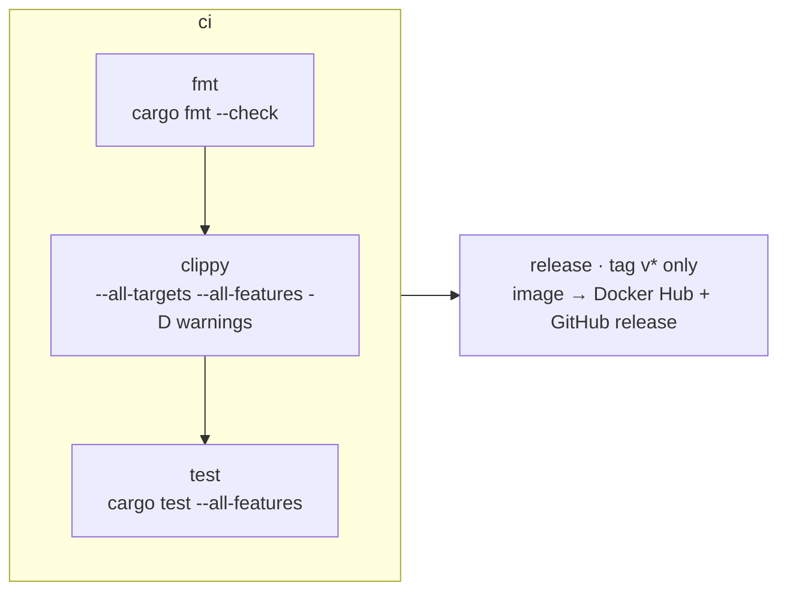

<p align="center">
  
</p>

<h1 align="center">Snodra Server</h1>

<p align="center">
  A stateless gRPC router for commands and queries between Snodra services.
</p>

<p align="center">
  <a href="https://github.com/snodra/snodra-server/actions/workflows/ci.yml"></a>
  <a href="https://github.com/snodra/snodra-server/releases"></a>
  
  
  
  <a href="https://snodra.damoreira.com/"></a>
  <a href="LICENSE"></a>
</p>

---

gRPC router for Snodra. Services open one bidirectional stream (`Hub.Connect`),
register the command and query types they handle, and the hub forwards each request to a live
instance of the owning service and relays the reply. Events never pass through here; they go
straight to the event store.

Design and protocol: see the umbrella docs `../kraken/docs/05-services/hub.md` and
`../kraken/docs/02-messaging.md`. The proto in `proto/hub.proto` is a copy of
`../kraken/protocol/hub.proto` (see `proto/README.md`). Items marked **Builder call** below are
implementation decisions that are not yet in the umbrella spec; the spec is updated separately.

## Table of contents

- [Build and test](#build-and-test)
- [Running locally](#running-locally)
- [Topology view](#topology-view)
- [Dashboard](#dashboard)
- [Event processors](#event-processors)
- [Processor control](#processor-control)
- [Event browser](#event-browser)
- [Security](#security)
- [Protocol summary](#protocol-summary)
- [Routing and limitations](#routing-and-limitations)
- [Connection lifecycle](#connection-lifecycle)
- [Observability](#observability)
- [Image](#image)
- [Layout](#layout)
- [CI/CD pipeline](#cicd-pipeline)
- [Contributing](#contributing)
- [License](#license)

## Build and test

Requires Rust 1.99.1 (`rust-toolchain.toml` pins it) and `protoc`. `cargo test` needs no Docker: the
[event browser](#event-browser)'s tests use a fake browser that answers over gRPC (`tests/common/browser.rs`). The
dashboard tests load each page in a headless Chrome or Chromium when one is found.

```sh
cargo build
cargo test
cargo clippy --all-targets -- -D warnings
cargo fmt --check
```

Unit tests live next to the code in `src/`; integration tests in `tests/` start a real hub on an
ephemeral port and drive it over gRPC (and over HTTP).

## Running locally

```sh
cargo run
```

| Variable | Default | Meaning |
|---|---|---|
| `SNODRA_SERVER_ID` | hostname + `-` + 8 random hex digits | identifies this hub process in `RegisterAck.hub_id` and the topology (`hubId`) |
| `SNODRA_SERVER_LISTEN` | `0.0.0.0:7000` | gRPC bind address |
| `SNODRA_SERVER_HTTP_LISTEN` | `0.0.0.0:7001` | HTTP bind address for the dashboard and its API; empty disables the HTTP listener |
| `SNODRA_SERVER_OTLP_ENDPOINT` | `http://otel-lgtm:4317` | OTLP gRPC endpoint for traces and metrics |
| `SNODRA_SERVER_LOG` | `info` | `tracing` filter, for example `snodra_hub=debug,info` |
| `SNODRA_SERVER_DEFAULT_TIMEOUT_MS` | `5000` | used when `Request.timeout_ms` is 0 and the type has no override |
| `SNODRA_SERVER_MAX_TIMEOUT_MS` | `60000` | upper clamp for `Request.timeout_ms` on types without an override |
| `SNODRA_SERVER_TIMEOUT_OVERRIDES` | none | per-type timeouts, `type=ms,type=ms` (for example `files.Upload=120000`); see [Request timeouts](#request-timeouts) |
| `SNODRA_SERVER_HEARTBEAT_INTERVAL` | `3s` | heartbeat period announced to clients in `RegisterAck`; `SNODRA_SERVER_HEARTBEAT_TIMEOUT` must be at least twice it |
| `SNODRA_SERVER_HEARTBEAT_TIMEOUT` | `10s` | dead-instance threshold (`10`, `10s` or `500ms`) |
| `SNODRA_SERVER_QUEUE_CAPACITY_PER_INSTANCE` | `10000` | requests queued for one instance before new ones are rejected |
| `SNODRA_SERVER_QUEUE_BYTES_PER_INSTANCE` | `64MiB` | encoded bytes queued for one instance before new requests are rejected (`B`, `KiB`, `MiB`, `GiB`, or plain bytes) |
| `SNODRA_SERVER_QUEUE_BYTES_TOTAL` | `512MiB` | encoded bytes queued over all instances together before new requests are rejected (reason `queue_bytes_total`; same units) |
| `SNODRA_SERVER_OWNER_GRACE` | `60s` | keep type ownership after the last instance leaves |
| `SNODRA_SERVER_MAX_STREAM_DURATION` | `10m` | a [streaming query](#query-modes) open for longer ends with `ReplyEnd{error = CANCELLED}` and its handler is cancelled; at least `1s` |
| `SNODRA_SERVER_SUBSCRIPTION_BUFFER` | `256` | updates of a [subscription](#query-modes) the hub holds while its sender owes credit; one more ends it with `ReplyEnd{error = RESOURCE_EXHAUSTED}`; positive |
| `SNODRA_SERVER_MAX_SUBSCRIPTIONS_PER_INSTANCE` | `1024` | subscription targets one handler instance serves at once; a subscription that would exceed it on any target is refused with `Error{RESOURCE_EXHAUSTED}` before anything is sent; positive |
| `SNODRA_SERVER_MAX_SUBSCRIPTION_DURATION` | `0` | a subscription open for longer ends with `ReplyEnd{error = CANCELLED}` and its targets are cancelled; `0` is unlimited, otherwise at least `1s` |
| `SNODRA_SERVER_SESSION_BUFFER` | `1024` | per-session outbound buffer, in messages |
| `SNODRA_SERVER_HANDSHAKE_TIMEOUT` | `10s` | a new `Connect` stream must send `Register` within this (`10`, `10s` or `500ms`) |
| `SNODRA_SERVER_DASHBOARD_ENABLED` | `true` | serve the dashboard (`/ui/`) and its API (`/api/v1/`, the processor controls included) on the HTTP port and keep the edge statistics; `false` makes them 404 (`true`/`false`, `1`/`0`, `yes`/`no`, `on`/`off`) |
| `SNODRA_SERVER_GRAFANA_URL` | none | Grafana base URL the dashboard links to; must be `http://` or `https://` without user info (`user:password@` is rejected at startup, as the link is served unauthenticated) |
| `SNODRA_SERVER_EDGE_STATS_MAX_EDGES` | `10000` | cap on `(sender service, type)` edges kept for the dashboard graph; at the cap the least recently used go first |
| `SNODRA_SERVER_EDGE_STATS_WINDOW` | `5m` | sliding window of the edge statistics, at least `10s` |
| `SNODRA_SERVER_PEERS` | none | the other hubs' dashboard base URLs as the operator's browser reaches them, comma-separated, for example `http://localhost:7001,http://localhost:7011` (this hub's own URL may be listed; the page skips it by hub id). Each must be `http://` or `https://` with a host and optional port, no user info, no path beyond `/`; normalised to origins (lowercase, default port dropped), duplicates removed, at most 16; anything else stops the hub at startup. See [Multiple hubs](#multiple-hubs) |

| `SNODRA_SERVER_AUTH_MODE` | `off` | `off`, `permissive` (evaluate every rule, log and count violations, allow everything) or `enforce` (refuse them); anything but `off` needs `SNODRA_SERVER_ACL_FILE`. See [Security](#security) |
| `SNODRA_SERVER_ACL_FILE` | none | TOML ACL: SHA-256 of each static token to its service, `handle` and `send` patterns; reloaded when it changes |
| `SNODRA_SERVER_JWT_ISSUER` | none | the `iss` a JWT credential must carry, exact match; unset: JWT credentials are off and refused as "not configured". Needs an auth mode other than `off`. See [Security](#security) |
| `SNODRA_SERVER_JWT_JWKS_URI` | `<issuer>/protocol/openid-connect/certs` | where the signing keys are fetched from (Keycloak's path, no OIDC discovery); separate from the issuer so a hub can fetch internally and validate the public issuer. `http://` warns once unless loopback or a single-label name. Without an issuer it is a startup error |
| `SNODRA_SERVER_JWT_AUDIENCE` | none | when set, a JWT's `aud` (string or array) must contain it |
| `SNODRA_SERVER_JWT_LEEWAY` | `30s` | clock skew tolerated on `exp`, `nbf` and `iat` |
| `SNODRA_SERVER_JWT_EXPIRY_GRACE` | `30s` | how long after `exp` a JWT session stays open without a refresh |
| `SNODRA_SERVER_JWKS_REFRESH` | `5m` | how often the signing keys are fetched again (an unknown `kid` fetches at most once per 30 s on top); positive |
| `SNODRA_SERVER_JWT_JWKS_CA` | none | an extra CA (PEM) trusted for the key fetch, on top of the platform roots; an unreadable file is a startup error whatever the URI scheme (unused, with a warning, over `http://`) |
| `SNODRA_SERVER_RELOAD_INTERVAL` | `5s` | how often the ACL and the TLS pairs are checked for changes; SIGHUP reloads at once |
| `SNODRA_SERVER_TLS_CERT`, `SNODRA_SERVER_TLS_KEY` | none | PEM pair of the gRPC listener, both or neither; the listener then accepts TLS only |
| `SNODRA_SERVER_TLS_CLIENT_CA` | none | PEM bundle of the CAs whose client certificates the gRPC listener accepts (mutual TLS); needs the gRPC pair; an unreadable or empty bundle is a startup error; reloaded with the certificates (a bad file keeps the previous CAs, counted); the HTTP port never asks for a certificate; with `AUTH_MODE=off` it authenticates nothing beyond the handshake (startup warning). See [Security](#security) |
| `SNODRA_SERVER_TLS_CLIENT_AUTH` | `optional` (when the CA is set) | `optional`: no certificate is fine (token or JWT), one that is presented must verify; `required`: a client without a valid certificate fails the handshake. Without `SNODRA_SERVER_TLS_CLIENT_CA` it is a startup error |
| `SNODRA_SERVER_HTTP_TLS_CERT`, `SNODRA_SERVER_HTTP_TLS_KEY` | the gRPC pair | PEM pair of the HTTP listener |
| `SNODRA_SERVER_TLS_HANDSHAKE_TIMEOUT` | `5s` | a TLS handshake that takes longer is dropped; positive |
| `SNODRA_SERVER_TLS_HANDSHAKES_PER_IP` | `32` | TLS handshakes in progress at once from one peer IP; more are dropped at once; `0` removes the cap |
| `SNODRA_SERVER_DASHBOARD_TOKEN` | none | at least 16 characters; when set `/api/v1/*` and the gRPC `Topology` call need `Authorization: Bearer <token>` |
| `SNODRA_SERVER_DASHBOARD_TOKEN_FILE` | none | a file holding the dashboard token (trailing newline trimmed, same rules as the variable); read at startup and again on the reload poll, so a rotation needs no restart. Wins over `SNODRA_SERVER_DASHBOARD_TOKEN` when both are set (as `SNODRA_MESSAGING_HUB_TOKEN_FILE` does in the client libraries). An unreadable or invalid file stops the hub at startup; at a reload it keeps the previous token and logs an error. Prefer it to the variable: an environment variable shows in `docker inspect` and `/proc` |
| `SNODRA_SERVER_DASHBOARD_WRITE_TOKEN`, `SNODRA_SERVER_DASHBOARD_WRITE_TOKEN_FILE` | none | at least 16 characters; the [processor controls](#processor-control)' token (`Authorization: Bearer <token>` on the mutating calls), which also reads what the dashboard token reads; the file variant is read and reloaded like `SNODRA_SERVER_DASHBOARD_TOKEN_FILE`. Equal to the dashboard token (whatever the source) is a config error at start, and a reload that would make them equal keeps both previous tokens. Unset and no ACL entry with `control = true`: the controls answer 403 `controls are disabled` |
| `SNODRA_SERVER_CONTROL_TIMEOUT` | `10s` | how long a control call waits for an instance's answer (pause, resume, a reset's prepare and finish, dead letters); at most `20s`, the 30 s reset lease minus its 10 s renewal period |
| `SNODRA_SERVER_RESET_TIMEOUT` | `120s` | how long the instance that executes a reset may take |
| `SNODRA_SERVER_EVENT_BROWSER_PAYLOADS` | `false` | ask the [event browser](#event-browser) for event payloads (record detail, `q`) for a request that presents the dashboard or write token (a token must be configured too) |
| `SNODRA_SERVER_EVENT_MAX_TAILS` | `4` | event tails open at once on this hub (1 to 1024); one more is 429 |

The event browser's own settings (sources, scan and time budgets, concurrent searches and tails, tail duration) are the
`snodra-event-browser` add-on's. `SNODRA_SERVER_KAFKA_BOOTSTRAP`, `SNODRA_SERVER_EVENT_TOPICS`,
`SNODRA_SERVER_EVENT_SEARCH_MAX_SCANNED`, `SNODRA_SERVER_EVENT_SEARCH_MAX_RESULTS`, `SNODRA_SERVER_EVENT_SEARCH_TIMEOUT`,
`SNODRA_SERVER_EVENT_MAX_SEARCHES`, `SNODRA_SERVER_EVENT_TAIL_DURATION` and `SNODRA_SERVER_GROUP_LAG_INTERVAL` are no longer
read: a hub that still sets one logs a startup warning naming it and starts as usual.

Durations accept `30` (seconds), `30s`, `500ms` and `5m`.

The topology view (`GET /api/v1/topology`, `snodra-server --topology`) is described in [Topology view](#topology-view),
the dashboard in [Dashboard](#dashboard).

- **Builder call:** `SNODRA_SERVER_OTLP_ENDPOINT` defaults to `http://otel-lgtm:4317`. Leaving it
  unset keeps that default; setting it to an empty string disables OTLP export, which is useful
  for `cargo run` without a collector. (For every other variable an empty value means "unset".)
- **Builder call:** `SNODRA_SERVER_HANDSHAKE_TIMEOUT` (default `10s`): a stream that sends nothing,
  or no `Register`, within it is closed with `DEADLINE_EXCEEDED` `no Register within 10s`. A
  `Register` with an empty `instance_id` or `service_name`, or with `initial_permits` 0, is closed
  with `INVALID_ARGUMENT`.
- Startup fails on a malformed `SNODRA_SERVER_TIMEOUT_OVERRIDES` (entry without `=`, empty type,
  non-numeric, zero or above `u32::MAX` milliseconds, a type listed twice) and when
  `SNODRA_SERVER_HEARTBEAT_TIMEOUT` is less than twice `SNODRA_SERVER_HEARTBEAT_INTERVAL` (one late
  heartbeat would evict).
- **Builder call:** on macOS, port 7000 is held by Control Center (AirPlay Receiver). Either disable
  AirPlay Receiver in System Settings or set `SNODRA_SERVER_LISTEN=0.0.0.0:7002` (7001 is the dashboard's HTTP port; map the compose
  host port accordingly).

## Topology view

The hub can show who is connected right now: every service with its live instances, which command
and query types each instance handles, who owns each type, and how many requests are in flight
(as handler and as sender). It never contains payloads or headers. The same snapshot is served
three ways:

```sh
grpcurl -plaintext -import-path proto -proto hub.proto localhost:7000 snodra.hub.v1.Hub/Topology   # gRPC, same port as Connect
curl localhost:7001/api/v1/topology                            # HTTP JSON (the dashboard API)
snodra-server --topology [--json]                                 # CLI inside the container
```

```sh
docker exec snodra-server /app/snodra-server --topology
docker exec snodra-server /app/snodra-server --topology --json
```

- `GET /api/v1/topology` is served on `SNODRA_SERVER_HTTP_LISTEN` (camelCase fields, `kind` as
  `COMMAND` or `QUERY`) with the rest of the [dashboard API](#dashboard). Besides the dashboard
  paths (`/`, `/ui`, `/ui/...`, `/api/v1/...`) every path is 404, and with
  `SNODRA_SERVER_DASHBOARD_ENABLED=false` every path is: the gRPC call and the CLI remain.
  **Builder call:** the HTTP endpoint is a second port (7001), because the gRPC port speaks only
  HTTP/2 gRPC. An empty `SNODRA_SERVER_HTTP_LISTEN` disables it.
- `snodra-server --topology` prints a table (`--json` prints the JSON). It probes `127.0.0.1` on the
  port of `SNODRA_SERVER_LISTEN` (or `--address host:port|https://host:port`) with a 3 s timeout, over
  TLS as `--tls-ca <pem>`, an `https://` address or the environment's TLS setting say, with
  `SNODRA_SERVER_DASHBOARD_TOKEN` from its environment when the hub has one. Exit codes: 0 success, 1 failure (hub
  unreachable or timeout), 2 usage error (unknown or conflicting flags; usage goes to stderr).
  With nothing connected it prints `no services connected` and a totals line.
- Without `SNODRA_SERVER_DASHBOARD_TOKEN` the topology has no authentication, like the rest of the
  port-7000 surface, except that with `SNODRA_SERVER_AUTH_MODE=enforce` the gRPC call needs an ACL token;
  with the token, the gRPC call and `GET /api/v1/topology` need it (see [Security](#security)).
- The hub has no gRPC server reflection, hence the `-proto` flags. grpcurl's proto-JSON prints
  int64 as strings and omits default values, so its output differs textually from
  `curl :7001/api/v1/topology`.

### Snapshot fields

Top level:

| Field | Type | Meaning |
|---|---|---|
| `hubId` | string | `SNODRA_SERVER_ID` |
| `hubStartedAtMs` | int64 | hub start, epoch milliseconds |
| `nowMs` | int64 | snapshot time, epoch milliseconds |
| `heartbeatTimeoutMs` | int64 | the configured `SNODRA_SERVER_HEARTBEAT_TIMEOUT`, in ms |
| `services` | list | one entry per service with at least one live session |
| `types` | list | one entry per owned type, including orphaned ones |
| `totals` | object | `services`, `instances`, `commandTypes`, `queryTypes`, `inFlight`, `queued` (all counts; `inFlight` includes queued requests) |

`services[]`: `serviceName` (string) and `instances[]`:

| Field | Type | Meaning |
|---|---|---|
| `instanceId` | string | instance id from `Register` |
| `connectedSinceMs` | int64 | when the session started, epoch ms |
| `lastHeartbeatAgeMs` | int64 | time since the last heartbeat, ms |
| `stale` | bool | `lastHeartbeatAgeMs` > a third of the eviction threshold (see below) |
| `inFlightAsHandler` | uint32 | requests currently being handled by this instance |
| `inFlightAsSender` | uint32 | requests this instance sent that have no terminal message yet |
| `commandTypes` | list of string | command types this instance registered |
| `queryTypes` | list of string | query types this instance registered (shared ones included) |
| `sharedQueryTypes` | list of string | the query types it registered as shared (`Register.shared_query_types`) |
| `clientVersion` | string | `Register.client_version`, for example `snodra-messaging/0.1.0`; empty when the client sent none |
| `permitsAvailable` | uint32 | permits left: requests the hub may still forward before the next `Permits` |
| `queued` | uint32 | requests waiting in the hub's queue for this instance |
| `loadFactor` | uint32 | `Register.load_factor` as applied (0 reads as 100) |
| `tags` | map | `Register.tags` |
| `connectedHubIds` | list of string | `InstanceStatus.connected_hub_ids` as last reported: the hubs the instance holds a stream to; empty when never reported |
| `statusAgeMs` | int64 | time since that report, ms; `-1` when never reported |
| `processors` | list | `InstanceStatus.processors` of that report, as kept (see [Event processors](#event-processors)): `name`, `subscription`, `source`, `eventStore`, `capabilities`, `state`, `segments[]` (`segment`, `position`, `committed`, `head`, `lag`, `replayUntil`), `processedTotal`, `failedTotal`, `deadLetters`, `lastError`, `lastErrorAtMs`, `eventTypes`, `deadLetterMode`, `replaying`, `operationId`; `[]` when never reported |

`types[]`:

| Field | Type | Meaning |
|---|---|---|
| `type` | string | the command or query type name |
| `kind` | string | `COMMAND` or `QUERY` |
| `ownerServices` | list of string | every owning service, sorted (one for an exclusive type) |
| `shared` | bool | a shared query type: many services may own it |
| `liveInstances` | uint32 | live instances of the owner (of all owners) that registered it |
| `orphaned` | bool | the owner has no live instance (ownership is held during the grace period) |
| `orphanedForMs` | int64 | how long it has been orphaned, ms; 0 when not orphaned |

`totals.inFlight` counts requests in the router, so it can differ from the per-instance sums when
a sender or handler is already gone. A scatter-gather counts once in `inFlight` and in its
sender's `inFlightAsSender`, and once per target in each handler's `inFlightAsHandler`.

### Consistency

A snapshot is three sequential reads (sessions, then registry, then router), each under its own
lock and never nested. It is not a single atomic cut: a request or a disconnect can land between
reads. Sessions are the base set: an instance appears only if it has a live session, and its
types and in-flight counts are attached by instance id (empty or zero when absent).

### Staleness

**Builder call:** an instance is `stale` when its last heartbeat is older than a third of the
eviction threshold (`SNODRA_SERVER_HEARTBEAT_TIMEOUT`).
It is still connected and still receives requests; the flag is an early warning before the hub
evicts it at the full timeout. A brief `stale: true` right before a heartbeat arrives is normal.

### Orphaned types

**Builder call:** when the last instance of a service leaves, its types stay in `types` with
`orphaned: true` and a growing `orphanedForMs` until `SNODRA_SERVER_OWNER_GRACE` expires and the
sweep removes them. Requests for an orphaned type fail with `NO_HANDLER`.

### Register rejections

**Builder call:** two additions to the registry rules.

- A type listed under both `command_types` and `query_types` in one `Register` is rejected with
  `INVALID_ARGUMENT`.
- Registering a type under a different kind than its current owner uses (for example a query
  type that the owner holds as a command) is rejected with `ALREADY_EXISTS`. A type's kind cannot
  change while it is owned; change it only after every instance of the owner has left and the
  owner grace sweep has removed the type.
- Shared query types (`Register.shared_query_types`, umbrella ADR 0017): a type registered
  exclusive by one registrant and shared by another (even of the same service) fails the later
  `Register` with `ALREADY_EXISTS`; a type listed as shared and as a command or exclusive query in
  one `Register` is `INVALID_ARGUMENT`. Like a kind, the flag changes only once the type is gone.

## Dashboard

A web dashboard is compiled into the binary and served on the HTTP port: open
`http://localhost:7001/` (it redirects to `/ui/`). It shows what the topology view shows, plus who
calls whom and how that goes, and controls the services' event processors. Decision record:
umbrella `docs/adr/0015-embedded-hub-dashboard.md`.

> **Authentication is opt-in for reads.** Without `SNODRA_SERVER_DASHBOARD_TOKEN` the dashboard and
> the reads of `/api/v1/` are open to anyone who reaches port 7001: keep the
> port on the private network (the page footer says the same). With the token set the page asks
> for it and every data endpoint needs it; see [Security](#security). The only writes, the
> [processor controls](#processor-control), always need the write token or an ACL credential with
> `control = true`, and are off when neither is configured.

| Page | Shows |
|---|---|
| Overview | totals (services, instances and how many are stale, types, in flight, queued, requests and errors over the window); a graph in three columns, sender services, types, owner services, with edge thickness by request count (log scale) and colour by error share (1 % warning, 5 % critical); hovering or focusing a node follows its traffic; a table of the same edges with requests, errors, p50 and p99 |
| Services | every service with its event processors (a count linking to the Processors page and a dead-letter badge) and its live instances: instance id, client version, permits, queued, in flight as handler and as sender, load factor, tags, heartbeat age with a stale flag, connected since, the hubs it reports (flagged when this hub is missing or the report is older than 15 s); the types each service handles. With peers under "All hubs": every reachable hub's instances merged by instance id, with "Seen by" and per-instance disagreements |
| Types | every type: kind, owners (with a "shared" badge for a shared query type), live instances, state (owned, orphaned for how long, no owner), senders, requests, errors, p50, p99; filters by text, kind and problems |
| Settings | hub id, version, start time, dashboard build, and every `SNODRA_SERVER_*` setting with its effective value and default |
| Processors | every (service, processor): subscription, source, event store (its capabilities in the title), worst state over its instances, instances, segments, lag (sum of the known lags), dead letters (or the mode `event-store` / `log`), the latest error with its age; a row opens to every instance's report and segments (position, committed, head and replay end as text, lag), kept open in the URL (`#/processors?open=service-b/orders`); filters by text and problems. Under "All hubs" merged over every reachable hub, the freshest report of an instance winning (see [Event processors](#event-processors)). While an [event browser](#event-browser) is connected, a second card lists the subscriptions with a committed position that no live instance reports (state, segments, lag, as `events/lag` of the browser's default source reads them, at most every 15 s); without a browser nothing extra |
| Dead letters | the processors that keep letters, and per processor (`#/dead-letters?service=…&processor=…`) its letters as one instance lists them through the hub (no payloads); with a write credential Retry, Retry all and Discard (confirmed). Read on demand, not live |
| Events | only while an event browser is connected (the navigation follows `version.eventBrowser.installed`; opened without one it says so): a search form (source, time presets or from/to, type with `*` prefixes, key, publishing service, correlation id, user id, event id, payload text where payloads are served), results newest first with "Load more" and the scan statistics, a record's headers and payload (pretty-printed JSON) or the reason it is hidden, a tail (new rows drawn once per animation frame, at most 500 kept, pause; `tail=on` in the page's URL opens it tailing); type and correlation id link to a search. This hub only. See [Event browser](#event-browser) |

Filters live in the URL (`#/types?q=orders&kind=QUERY`), so a filtered view can be linked. With
`SNODRA_SERVER_GRAFANA_URL` set the header links to Grafana. With `SNODRA_SERVER_PEERS` set the header
lists this hub and every peer with its reachability, and offers "All hubs" (the default,
remembered per browser) or "This hub"; see [Multiple hubs](#multiple-hubs).

- **Builder call:** any client can create thousands of types and edges by sending type names
  nobody owns (`NO_HANDLER`), so the pages draw a bounded amount. The graph draws at most 60
  type nodes (registered types first, then by requests) plus up to 40 more with a problem (no
  owner, orphaned, 1 % errors or more), and says how many more are hidden; the filter and the
  Types page reach the rest. The edges table and the Types table show at most 200 rows (the
  busiest edges; the first types) with a "showing 200 of N" note; filters search every row. A
  refresh redraws the graph only when its nodes or edges change, otherwise it updates edge
  widths, colours and labels in place.

### JSON API

All under `/api/v1/`, `GET`, JSON (camelCase), `Cache-Control: no-store`:

| Path | Body |
|---|---|
| `topology` | the topology snapshot, as the gRPC `Topology` returns it |
| `types` | `types[]`: `type`, `kind`, `owners` (a list, room for shared query types), `registered` (false for a type only seen in traffic, i.e. answered `NO_HANDLER`), `instances`, `liveInstances`, `orphaned`, `orphanedForMs`, `senders`, `traffic {count, errors, p50Ms, p99Ms}`; `windowMs` |
| `graph` | `nodes[]` (`kind: service` with `instances`, `staleInstances`; `kind: type` with `typeKind`, `owners`, `registered`, `orphaned`; ids `service:<name>`, `type:<name>`), `edges[]` (`from`, `to`, `role: send` sender -> type, `role: handle` type -> owner merged over senders, every owned type even without traffic; `count`, `errors`, `p50Ms`, `p99Ms`), `totals`, `windowMs`, `maxEdges`, `evictedEdges` |
| `settings` | `settings[]`: `name`, `value`, `default`, `secret`, `description`; a secret is listed with `value: null` (none exist yet; URL user info is replaced by `***`) |
| `version` | `hubId`, `version`, `startedAtMs`, `nowMs`, `buildId`, `grafanaUrl` (never with user info), `windowMs`, `peers` (`SNODRA_SERVER_PEERS` as origins; empty without peers), `eventBrowser` (`installed`, `payloads`) |
| `events`, `events/{source}/{segment}/{position}`, `events/sources`, `events/lag`, `events/tail` | the [event browser](#event-browser) |
| `processors` | the event processors per service, aggregated over the instances (see [Event processors](#event-processors)) |
| `services/{service}/processors/{processor}/dead-letters?limit=` | a processor's dead letters, listed by one instance; the mutating routes under `services/` are in [Processor control](#processor-control) |
| `stream` | server-sent events: `summary` (`hubId`, `buildId`, `nowMs`, `totals`, `staleInstances`, `requests`, `errors`, `revision`) at once, within 0.5 s of a change and at least every 2 s; the page refreshes its view on each and polls `topology` every 2 s while the stream is unavailable |

- **Builder call:** at most 64 streams are open at once; the 65th gets `503` and its page polls.
  Streams end at shutdown.
- **Builder call:** all streams read one shared summary, recomputed every 0.5 s only while at
  least one stream is open (edge totals are kept as requests arrive, so this does not walk the
  edges); without a stream nothing is computed.
- **Builder call:** `revision` hashes services, instances, their registrations, stale flags and
  reported hubs, type ownership and the set of edges, not counters or ages, so a page can
  refresh at once on a structural change.

### Edge statistics

The router counts every request that reaches a terminal state on its `(sender service, type)`
edge: requests, errors (any outcome but `ok`) and its latency. In memory only, like everything
in the hub.

- Window: `SNODRA_SERVER_EDGE_STATS_WINDOW` (5 min) in ten slots (30 s each), so a view covers
  between 4.5 and 5 minutes. Expired edges are swept once per slot.
- Latency: a sparse log-scale histogram per slot, 8 bins per power of two; p50 and p99 are off by
  at most about 4.4 %.
- **Builder call:** requests the hub answers without routing them (`NO_HANDLER`,
  `INVALID_REQUEST`, a duplicate id) count as errors but have no latency, so they do not drag
  the percentiles to zero. Requests whose sender disconnected are not counted (as in
  `snodra_server_requests_total`). The `handle` edge of a type merges all its requests, including
  `NO_HANDLER` answers while the owner had no instance.
- **Builder call:** cap `SNODRA_SERVER_EDGE_STATS_MAX_EDGES` (10 000). At the cap a new edge drops
  the least recently used edges, 1 % of the cap at a time (at least one), counted in
  `evictedEdges` and shown on the overview. Names longer than 200 bytes are cut (with `…`), so
  a client cannot grow the map with huge type names.
- **Builder call:** error colours start at 1 % (warning) and 5 % (critical) of the window's
  requests; below 1 % the edge keeps the neutral colour and the table still shows its errors.
- `SNODRA_SERVER_DASHBOARD_ENABLED=false` also stops collecting the statistics.

### Assets, caching and headers

`ui/` holds `index.html`, `app.css`, `favicon.svg` and plain ES modules (`app.js`, `api.js`,
`live.js`, `hubs.js`, `graph.js`, `dom.js`, `format.js`, `pages/*.js`). There is no third-party code, no
package manager and no build step; the files are compiled into the binary with `rust-embed`.

- `/ui/` is served `no-cache` and references every asset under `/ui/v/<build>/`, where `<build>`
  is a hash of all embedded files. Those URLs are `immutable`, so a new hub version is picked up
  at once and nothing stale is cached. **Builder call:** a request for another build id is
  answered with the current file, `no-cache` (a tab open across an upgrade keeps working; it
  also shows a "reload" banner).
- Every dashboard and API response carries `Content-Security-Policy: default-src 'self';
  script-src 'self'; style-src 'self'; img-src 'self'; connect-src 'self' <peers>; font-src 'self';
  object-src 'none'; base-uri 'none'; form-action 'none'; frame-ancestors 'none'` (`<peers>`:
  the `SNODRA_SERVER_PEERS` origins, nothing without peers), plus
  `X-Content-Type-Options: nosniff`, `Referrer-Policy: no-referrer`, `X-Frame-Options: DENY`.
  Names registered by clients only ever reach the page as text, also those read from peers.
- **Builder call:** `/` and `/ui` redirect to `/ui/` with `307` and a relative `Location`
  (`ui/`), so the redirect works behind a proxy that mounts the hub under a path and is not
  cached past a `SNODRA_SERVER_DASHBOARD_ENABLED=false`.

### Multiple hubs

Decision record: umbrella `docs/adr/0016-multi-hub-ha-without-hub-to-hub-traffic.md`. Hubs never
talk to each other; each instance connects to every hub. The hub side:

- **Instance status.** A client sends `ClientMessage.status`
  (`InstanceStatus{connected_hub_ids, handlers_in_flight}`, every 5 s). The hub keeps the latest
  report per session, replaced by each and dropped with the session, and shows it as
  `connectedHubIds` / `statusAgeMs`. **Builder call:** at most 64 ids of at most 128 bytes are
  kept; empty, over-long (ignored, never cut) and duplicate ids are dropped.
- **Dashboard peers.** The page reads `/api/v1/topology` of every `SNODRA_SERVER_PEERS` entry from
  the browser (3 s timeout each; on every refresh of a merging page, otherwise every 5 s for the
  header) and, under "All hubs", merges them: the Services page by instance id with "Seen by",
  the Overview with totals over all hubs and a list of disagreements (at most 200 rows): an
  instance missing on a reachable hub, an instance with different types on different hubs, a
  type owned by different services on different hubs, an instance whose reported hubs omit a
  reachable hub. An unreachable peer is shown as unreachable, not as a disagreement. The traffic
  graph and the Types page stay per hub.
- **CORS.** `/api/v1/*` answers an `Origin` that is exactly one of `SNODRA_SERVER_PEERS` with
  `Access-Control-Allow-Origin: <that origin>` (and `Vary: Origin` whenever peers are set), never
  a wildcard, never credentials; a preflight is `204` (`GET` only) for such an origin and `403`
  otherwise. Other origins, the page and its assets get no CORS header.

Developing the page: edit `ui/`, `cargo run` (assets are embedded in debug builds too) and
reload. `tests/dashboard_ui.rs` checks that every referenced asset and every import resolves,
and loads each page in headless Chrome when one is installed (`SNODRA_SERVER_TEST_BROWSER=<path>`
picks a binary, `none` skips; CI without a browser runs the static checks only).

## Event processors

Decision records: umbrella `docs/adr/0022-named-event-processors-status-and-dead-letters.md` and
`docs/adr/0027-modular-event-store.md`. Each service instance runs its event handlers in event processors (`default`,
plus one per named processing group, each its own subscription to the event store) and reports them every 5 s in
`InstanceStatus.processors`. The hub reads no event store for them and stores nothing else: it keeps the latest report
per session and shows it.

- **The report.** A client fills `InstanceStatus.processors` (`ProcessorStatus{name, subscription, source,
  event_store, capabilities, state, segments[], processed_total, failed_total, dead_letters, last_error,
  last_error_at_ms, event_types, dead_letter_mode, replaying, operation_id}`, `SegmentStatus{segment, position,
  committed, head, lag, replay_until}`). Segments and positions are opaque strings only the event-store add-on reads
  (each add-on picks their format), empty when unknown; `lag` is a number, `-1` when unknown. Each report
  replaces the list; it is dropped with the session.
- **Builder call: bounds.** At most 32 processors per report, 1024 segments, 16 capabilities and 256 event types each;
  names are cut at 64 bytes, subscription and source at 256, the event store and a capability at 64, the last error at
  512, an event type at 256, the mode at 32, always at a UTF-8 boundary. A segment name or a position is never cut (a
  cut position would be a wrong one): a segment named in more than 128 bytes is dropped and a longer position reads as
  unknown. An empty or repeated name, an empty or repeated segment, empty capabilities and event types are dropped;
  lags below -1 read as -1; an unknown state number reads as `UNSPECIFIED`. Never an error to the client. Segments
  are sorted with decimal names by value (`2` before `10`), then other names.
- **Topology.** `InstanceTopology.processors` (field 19) over gRPC, `processors` in `GET /api/v1/topology`, and
  under each service in `snodra-server --topology` a table with one row per (processor,
  instance): state, subscription, source, segments (runs of decimal names as ranges, `0-2,5`), the known lag,
  processed, failed, dead letters (or `(event-store)` / `(log)`), the last error with its age, cut at 60 characters. Every cell and service header of the
  `--topology` table is shown on one line (control characters such as newlines and escapes become spaces, runs of
  them one): names, ids, types and errors all come from clients.
- **`GET /api/v1/processors`** (dashboard token, CORS for the peers, off with the dashboard):

  ```json
  { "hubId": "hub-a", "nowMs": 1762250000000,
    "services": [ { "serviceName": "service-b", "deadLetters": 2,
      "processors": [ { "name": "orders", "subscription": "service-b.orders", "source": "kraken.events",
        "eventStore": "<event store name>", "capabilities": ["browse", "lag", "native-dead-letter", "replay"],
        "deadLetterMode": "collection", "state": "FAILING", "instancesReporting": 2,
        "assignedSegments": 2, "lag": 13, "deadLetters": 2, "processedTotal": 6, "failedTotal": 1,
        "eventTypes": ["examples.OrderPlaced"],
        "lastError": { "message": "handler failed: boom", "atMs": 1762249990000, "instanceId": "b-1" },
        "instances": [ { "instanceId": "b-1", "statusAgeMs": 1200, "state": "FAILING", "segments": [ … ], … } ] } ] } ] }
  ```

  Per processor: the worst state of its instances (`FAILING`, `UNSPECIFIED`, `STARTING`, `PAUSED`, `STOPPED`,
  `RUNNING`); `assignedSegments` counts distinct segments (one two instances report during a reassignment counts once,
  as the freshest report has it); `lag` sums their known lags (`null` when none is known); `deadLetters` is the
  highest count an instance reported (they all sample the same collection); totals are sums; `lastError` is the most
  recent; subscription, source, event store, capabilities and mode come from the freshest report. Services without a processor are not listed.
- **Dashboard.** The Processors page re-aggregates `instances[]` in the browser with the same rules
  (`ui/processors.js`), over every reachable peer under "All hubs": an instance two hubs hold counts once, with its
  freshest report (lowest `statusAgeMs`); a peer that does not answer is unreachable. A report also carries
  `replaying`, `operationId` and per segment `replayUntil`; the page shows PAUSED and STOPPED (with the reset's
  operation id) and a replaying badge, and with a write credential Pause, Resume and, only when the processor's event
  store declares the `replay` capability, Reset (see [Processor control](#processor-control)): to the earliest or the
  latest positions, a time, or explicit positions, one `segment=position` per line, split at the first `=` (a
  position is opaque and may hold `,` or `=`).

## Processor control

Decision record: umbrella `docs/adr/0023-hub-control-plane-for-event-processors.md` (the operator guide with every
JSON body is the umbrella's `docs/05-services/hub.md`, "Processor control"). The hub is a stateless control plane:
`src/control.rs` sends `ServerMessage.control` to every live session of the service whose latest status lists the
processor, matches each `ClientMessage.control_reply`
to its request by `control_id` and session, times requests out (`SNODRA_SERVER_CONTROL_TIMEOUT`, 10 s; a reset's execute
`SNODRA_SERVER_RESET_TIMEOUT`, 120 s), fails them at once when the session leaves, and drops (and counts) replies nobody
waits for. The state lives in each service's store (`processor_control`), not in the hub.

| Route under `/api/v1/services/{service}/processors/{processor}/` | Credential | Does |
|---|---|---|
| `POST pause`, `POST resume` | write | on every instance that reports the processor; 200 with the counts when at least one persisted it |
| `POST reset` with `{"to":"earliest"}`, `{"to":"latest"}`, `{"to":{"timestampMs":n}}` or `{"to":{"positions":[{"segment":"0","position":"12"}]}}` (segments and positions strings of 1 to 128 bytes; at most 1024 positions and a 64 KiB body, room for 1024 decimal segments with 20-digit positions; every other control body at most 4 KiB) | write | prepare every instance (lease 30 s, renewed every 10 s), execute on the freshest, finish all; refused up front, no instance asked: 409 while this hub runs a reset of the processor, and 409 `UNSUPPORTED` when the freshest report's event store does not declare the `replay` capability (ADR 0027) |
| `GET dead-letters?limit=n` | read | the oldest `n` letters (default 50, at most 100) and the total, from the instance with the freshest status |
| `POST dead-letters/{id}/retry`, `POST dead-letters/retry-all`, `DELETE dead-letters/{id}` | write | the library's retry, retry all and discard |

- **Write credential:** `Authorization: Bearer` with `SNODRA_SERVER_DASHBOARD_WRITE_TOKEN` (constant-time against its
  digest) or a static ACL token or JWT whose ACL entry has `control = true`. Neither configured: every write is 403
  `controls are disabled`. The dashboard token never writes; the write token also reads.
- **Status codes:** 400 bad body, 401 no or an unknown credential, 403 no right or disabled, 404 unknown service or
  processor (no instance reports it), 409 locked, refused (`SUBSCRIBERS_ACTIVE`, `UNSUPPORTED` when the event store
  lacks the capability, ...) or a reset already running, 502 an instance failed, 504 timeout. The dashboard's status
  line shows the refusal code and the instance's message. A refused execute is not always "nothing changed": after the reset handlers ran the
  instance's message says what changed, and an execute that timed out (504) or whose instance left (502) may still
  finish or may already have run reset handlers or deleted markers (its `error.message` says so). The finish goes out
  once the lease renewals in flight are answered, so a late renewal never re-takes the lock.
- **Audit:** one `info` line `control` per call past the credential check (caller, service, processor, action,
  outcome, duration, the reset's operation id) and `snodra_server_control_total{action,outcome}`.
- **Dashboard:** a second password field, "Write token" (`sessionStorage`, never a URL), shows the controls on the
  Processors and Dead letters pages; with peers a control goes to the hub that served the page, which reaches every
  instance.

```bash
curl -s -X POST -H "Authorization: Bearer $SNODRA_SERVER_DASHBOARD_WRITE_TOKEN" -H 'Content-Type: application/json' \
  -d '{"to":"earliest"}' http://localhost:7001/api/v1/services/service-b/processors/audit/reset
```

## Event browser

Decision records: umbrella `docs/adr/0027-modular-event-store.md` (the event browser as an add-on of the hub) and
`docs/adr/0025-hub-event-browser-reads-kafka.md` (the routes, bounds and payload rules, which stay). The hub reads no
event store. The `snodra-event-browser` add-on connects to the hub like any service and handles the reserved query
types `snodra.events.Search`, `snodra.events.Get`, `snodra.events.Sources`, `snodra.events.Lag` (point queries) and
`snodra.events.Tail` (a streaming query). Each `/api/v1/events*` call becomes one hub-internal query to a live browser
instance (`Router::query_internal`, `Router::stream_internal`), routed, timed and flow-controlled like a client's;
`src/events.rs` builds the requests, reads the answers and keeps the payload rules. Whether a browser is installed is
read from the registry (a live instance handling `snodra.events.Search`; not the type's owner kept through
`SNODRA_SERVER_OWNER_GRACE` after the last browser left), not from a setting, and per hub: a hub answers the
events routes only while a browser is connected to *that* hub. The add-on connects to every hub of its list, as every
service instance does, so each hub of a deployment has it.

| Route under `/api/v1/` | Query | Answer |
|---|---|---|
| `GET events?source=&from=&to=&type=&key=&service=&correlationId=&userId=&eventId=&q=&limit=&cursor=` | `Search` | a page of summaries, newest first: `{source, missing?, results, scanned, exhausted, stoppedBy, cursor}`; a summary is `{source, segment, position, timestamp, key, keyTruncated?, headers, size}` (the seven library headers only, never a payload) |
| `GET events/{source}/{segment}/{position}` | `Get` | the summary, every header (`allHeaders`, `headersOmitted`), and `payload` / `payloadBase64` / `payloadTruncated` or `payload.hidden` |
| `GET events/sources` | `Sources` | `{sources: [{source, missing?, segments: [{segment, first, head}]}]}`, the default source first |
| `GET events/lag?source=` | `Lag` | `{source, missing?, subscriptions: [{subscription, state, members, segments: [{segment, committed, head, lag}], lag}], truncated}`, live instances or not, by lag |
| `GET events/tail?source=&<filters>` | `Tail` | server-sent `start` (`{source, segments, endsAtMs}`), `record` (summaries), `heartbeat` (`{nowMs}`), `end` (`{reason}`: `maxDuration`, `slowReader`, `shutdown`, `failed`) |

`source` names the event store's source (the browser's default when absent); `service` filters on the publishing
service (the record header `source`). Empty parameters count as absent; times are epoch ms or RFC 3339.

- **Reads** like every `/api/v1/` read: the dashboard token, or the write token. No browser connected: every route is
  404 `{"error":"event browser not installed"}` (the Events page leaves the navigation).
- **Errors:** the hub refuses itself, before asking, what it can tell is wrong: 400 for a `limit` that is not a
  positive whole number, a tail with `from`, `to` or `cursor`, a filter or source (of a search, a tail or the lag)
  over 1 KiB, a cursor over 64 KiB (the browser's bound: it holds a place per segment; a GET's URI is at most 65 534
  bytes, 414 beyond, so a cursor of up to some 65 000 bytes, about 2 400 segments, fits), a segment or position over 128 bytes. The browser's own errors map to 400 (`invalid`), 404
  (`not-found`), 429 with `Retry-After: 1` (`busy`) and 503 (`unavailable`), with its message (cut to 512 bytes); a
  request it could not decode (`INVALID_REQUEST`) is 400 "the event browser could not read the request"; no answer
  within the deadline is 504; anything else (the browser left, its own error without those details, an answer that is
  not the expected JSON or over 2 MiB, a tail part over 64 KiB) is 502 "the event browser failed to answer", never the
  browser's raw words.
- **Deadlines:** a point query asks a 30 s timeout, clamped by the router as any client's (`SNODRA_SERVER_MAX_TIMEOUT_MS`,
  and `SNODRA_SERVER_TIMEOUT_OVERRIDES` per `snodra.events.*` type); a search asks the browser for a time budget 2 s under
  that deadline, so it answers what it found (`stoppedBy: "timeBudget"`) before the hub gives up.
- **Tail:** the hub answers once the browser's `start` came (a refused tail is an HTTP error, not a stream). The
  `start` must arrive within the internal stream's idle timeout (`SNODRA_SERVER_DEFAULT_TIMEOUT_MS`, 5 s by default,
  counted from the forward to the browser), else the tail is 504; a `SNODRA_SERVER_TIMEOUT_OVERRIDES` entry for
  `snodra.events.Tail` raises it for a source with many segments or a slow store. It asks a
  heartbeat of two fifths of the internal stream's idle timeout (2 s with the default 5 s; between 100 ms and 15 s) and
  turns each `heartbeat` part into the SSE heartbeat, stamped with the hub's clock, and a longest duration 2 s under
  `SNODRA_SERVER_MAX_STREAM_DURATION`. A reader that leaves cancels the browser's tail (`Cancel`); a browser that goes away
  or sends a part the hub cannot read ends the stream with `end` `failed`; this hub stopping ends it with `shutdown`.
  At most `SNODRA_SERVER_EVENT_MAX_TAILS` (4, at most 1024) tails are open on a hub; one more is 429.
- **Payloads** (the detail, `q`) only with `SNODRA_SERVER_EVENT_BROWSER_PAYLOADS=true`, a dashboard or write token
  configured, and one presented: only then does the hub ask the browser for the payload (`Get.payload: true`) or send
  `q`. Otherwise `"payload": {"hidden": "payloads-off" | "no-token-configured" | "no-token-presented", "reason":
  "..."}` and `q` is 403 before the browser is asked. A payload the hub did not ask for is dropped, whatever the
  browser sends. Each payload served: one `info` line `event payload served` (caller, source, segment, position, size,
  correlation id) and `snodra_server_event_payload_views_total`; a payload search: one line `event payload search`
  (caller, source, tail, correlation id; never the text). Never logged, cached, in a metric, a result, the tail or an
  error.
- **Who asked:** each query carries the headers `userId` (the token presented, `dashboard-token` or `write-token`,
  when one was) and `correlationId` (the request's `X-Correlation-Id` when it is 1 to 128 visible ASCII characters,
  else a fresh one); every answer carries `X-Correlation-Id` back, and the audit lines the same id. The sender is the
  hub itself (service `snodra-server`, instance `snodra-server/<uuid>`: no client may register that service name or that
  instance prefix). The browser treats `userId` and `correlationId` as information for its logs, not as an identity:
  any client allowed to send a `snodra.events.*` type can set them.
- **Bounds** of the reads (records scanned, results, time per search, concurrent searches and tails, tail duration,
  buffer for a slow reader) are the add-on's settings.
- **Metrics:** `snodra_server_event_browser_requests_total{kind=search|record|sources|lag|tail,
  outcome=ok|bad_request|forbidden|not_found|too_many|unavailable|not_installed|timeout|failed}`,
  `snodra_server_event_browser_scanned_records` (as the browser reports it), `snodra_server_event_tails` (open on this hub),
  `snodra_server_event_payload_views_total`. The lag of subscriptions without a live instance is the add-on's metric.

To install a browser under access control, give its credential the `event-browser` right; nothing else may handle a
`snodra.events.*` type ([Security](#security)):

```toml
[[service]]
name = "snodra-event-browser"
event-browser = true
```

With `SNODRA_SERVER_AUTH_MODE` `off` (the default) or `permissive`, the ACL decides nothing: any connected client may
register the `snodra.events.*` types or send them, and a client that sends them reads events straight from the
browser, without the hub's payload rules or audit lines. Run the browser with access control enforced wherever those
rules matter.

```bash
H="Authorization: Bearer $SNODRA_SERVER_DASHBOARD_TOKEN"
curl -s -H "$H" 'http://localhost:7001/api/v1/events?correlationId=c-7f1e&limit=20'
curl -s -H "$H" 'http://localhost:7001/api/v1/events/kraken.events/3/1841'
curl -sN -H "$H" 'http://localhost:7001/api/v1/events/tail?type=orders.*'
curl -s -H "$H" 'http://localhost:7001/api/v1/events/lag'
```

## Security

Decision records: umbrella `docs/adr/0018-hub-access-control.md`,
`docs/adr/0019-hub-jwt-authentication.md` and `docs/adr/0020-hub-mutual-tls.md`; operator how-to:
umbrella `docs/06-security.md`. Everything here is opt-in; the default (`off`) checks nothing.

**Service tokens and the ACL.** With `SNODRA_SERVER_AUTH_MODE=enforce` a service must send a static
token in `Register.credentials.token`. The ACL file (`SNODRA_SERVER_ACL_FILE`) holds one `[[token]]`
table per token, keyed by the token's SHA-256 (never the token):

```toml
[[token]]
token_sha256 = "<64 hex characters from `snodra-server acl hash -`>"
service = "billing-service"          # the only service name this token may register as
handle  = ["billing.*"]              # types it may handle: commands, queries, shared queries
send    = ["orders.*"]               # types it may send, in every request mode
```

Patterns are an exact type, `prefix.*` or `*`. `control = true` lets the entry's credentials call the
[processor controls](#processor-control); `event-browser = true` lets them register the event browser's
reserved `snodra.events.*` query types (`snodra-event-browser`), which no `handle` pattern grants, not even
`*` (a `handle` pattern that reaches for them, `snodra.*`, `snodra.events.*` or one of the types, logs a warning when
the file is read; a bare `*` does not). Sending a
`snodra.events.*` type likewise needs a `send` pattern that names it, `snodra.events.*` or the type itself (`*` and
`snodra.*` do not grant it): an operator who grants one lets that service read events directly from the browser,
without the hub's payload rules. `contexts` only accepts `["default"]`. Generate a token with `openssl rand -hex 32` and hash it without echoing it:
`printf %s "$TOKEN" | snodra-server acl hash -` (or `snodra-server acl hash <token>`).

| Violation | `enforce` | `permissive` |
|---|---|---|
| no credentials, unknown token | stream closed with `UNAUTHENTICATED` | logged, counted, allowed |
| `jwt` credentials with no `SNODRA_SERVER_JWT_ISSUER` | `UNAUTHENTICATED` "jwt credentials are not configured on this hub" | same |
| an invalid JWT (expired, wrong issuer or audience, bad signature, `none`/`HS*`, an ID or refresh token) | `UNAUTHENTICATED` with a short reason, never the token | logged, counted (`jwt_invalid`), allowed as unauthenticated |
| a JWT for another service (`azp` differs), or for a service with no `[[service]]` table | `PERMISSION_DENIED` "token azp `<a>` is not service `<b>`" / "no ACL entry for service `<a>`" | logged, counted, allowed |
| a JWT before the first fetch of the signing keys | `UNAVAILABLE` "jwks not loaded yet" (clients retry) | the same, counted (`jwks_unavailable`) |
| a JWT whose `kid` is not in the key set and no fetch made for it has looked yet (a rotation) | `UNAVAILABLE` "signing key not known yet" (clients retry at the normal backoff); `UNAUTHENTICATED` "unknown signing key" once a fetch made for it found it missing | the same, counted (`jwks_unavailable` / `jwt_invalid`) |
| a JWT session past `exp` + `SNODRA_SERVER_JWT_EXPIRY_GRACE` without a refresh | stream closed with `UNAUTHENTICATED` "credentials expired" | counted once (`expired`), logged once, session kept |
| a service name the token does not grant, a handled type outside `handle` | stream closed with `PERMISSION_DENIED`, naming the type | logged, counted, allowed |
| a handled `snodra.events.*` type without `event-browser = true` | stream closed with `PERMISSION_DENIED` "service `<s>` may not handle type `<t>`: snodra.events.* types need the event-browser right" | logged, counted (`event_browser_denied`), allowed |
| a handled `snodra.events.*` type and another type outside `handle` | as above: the event-browser denial is the one reported | as above |
| a request for a type outside `send` (unary, scatter-gather, streaming, subscription); for a `snodra.events.*` type, a `send` without a pattern naming `kraken.events` | `Error{PERMISSION_DENIED}`, nothing routed | logged, counted, routed |
| a `Register` whose instance id starts with `snodra-server/` or whose service name is `snodra-server` (reserved for the hub's own requests) | stream closed with `INVALID_ARGUMENT`, in every mode | the same |
| a `Register` whose instance id belongs to a live session of **another service** | stream closed with `PERMISSION_DENIED` "instance id `<8 chars>` belongs to another service"; nothing of the holder changes | the same: logged, counted (`instance_takeover`) **and refused**, because handing one service's queue and pending replies to another is never legitimate |
| the gRPC `Topology` call without the dashboard token or an ACL token | `UNAUTHENTICATED` | allowed when no dashboard token is set; logged, counted (`topology_unauthenticated`) |

A reconnect of the **same** service takes over its instance id (also between two ACL
entries of one service, as in a token rotation). With `off` an instance id may change service.

The ACL reloads when the file changes (5 s poll, or SIGHUP); a file that does not parse keeps the
previous ACL (`snodra_server_acl_generation`, `snodra_server_acl_reload_errors_total`). Live sessions are
judged again on a change: a removed token or a registration the file no longer allows closes the
session. Violations are counted in `snodra_server_auth_violations_total{reason,service}`; logs show a
token only as the first 8 hex characters of its digest. Roll out with `permissive` first.

Refusals are logged once per refused `Register` (the status sent back lists up to 10 forbidden types,
then "and N more"), a client-chosen service name or type is cut to 128 characters in logs and
messages, and each reason logs at most 10 lines per 10 s, then one notice and, when the next window
opens, how many lines were dropped. The metric counts every refusal regardless.

**JWT credentials.** Decision record: umbrella `docs/adr/0019-hub-jwt-authentication.md`. A
service may register with a Keycloak client-credentials access token in
`Register.credentials.jwt` instead of a static token. Set `SNODRA_SERVER_JWT_ISSUER` (and an auth
mode other than `off`); the keys are fetched from `SNODRA_SERVER_JWT_JWKS_URI` in the background, at
startup, every `SNODRA_SERVER_JWKS_REFRESH` and, throttled to once per 30 s, when a token names an
unknown `kid` (a rotation needs no restart; a failed fetch keeps the last good keys; startup never
waits for Keycloak). Algorithms `RS256/384/512`, `PS256/384/512`, `ES256/384`; `none` and `HS*` are
refused. Checked: signature, `iss` (exact), `exp`, `nbf`, `iat` (with `SNODRA_SERVER_JWT_LEEWAY`), `aud`
when `SNODRA_SERVER_JWT_AUDIENCE` is set, `typ` when present (must be `Bearer`), and `azp` (required;
it must equal `Register.service_name`). The rights come from a **`[[service]]` table** named after
the service, never from a `[[token]]` entry (and `[[service]]` tables never apply to static tokens):

```toml
[[service]]
name   = "billing-service"   # the token's azp, unique among [[service]]
handle = ["billing.*"]       # the same patterns, `control`, `event-browser` and `contexts` as [[token]]
send   = ["orders.*"]
```

A JWT session expires at `exp` plus the grace unless the client sends `ClientMessage.credentials`
with a fresh credential for the same service (a token session may move to a JWT and back; handled
types are judged again against the new entry; one refresh per second per session is looked at, the
rest are counted as `throttled` and dropped silently, so send at most one per renewal; a refresh whose
`kid` is not known yet is waited for at most 1.5 s and then, if still not judgeable, counted as
`unavailable` and dropped while the session keeps its old credentials; no reply on success; `off`
ignores it). The wall clock decides the expiry: the session's timer wakes at `exp` plus the grace or
after 60 s, whichever is first, so a clock step or a suspend never closes it early and delays the close
by at most 60 s. A reload that removes the
service's table closes its session in `enforce`. The topology and the dashboard show each
instance's `authKind` (`token`, `jwt`, `certificate`, `none`), a JWT's or certificate's `expiresAt` and a
certificate's `certFingerprint`. In Keycloak, give each
service a confidential client with service accounts only and client id = service name, add an
audience mapper and set `SNODRA_SERVER_JWT_AUDIENCE`; a user's access token (`azp` = the gateway
client) must never get a `[[service]]` table. A token is never logged. The gRPC `Topology` call
in `enforce` also accepts a valid JWT, or a client certificate, of a service that has a table.

**Client certificates.** Decision record: umbrella `docs/adr/0020-hub-mutual-tls.md`. Set
`SNODRA_SERVER_TLS_CLIENT_CA` (with the gRPC pair) and the gRPC listener asks for client certificates
(`SNODRA_SERVER_TLS_CLIENT_AUTH`: `optional` by default, `required` to refuse a client without one; a
certificate that is presented must always verify against the bundle, or the handshake fails). A
service authenticates with a certificate that carries **exactly one URI SAN
`snodra://service/<name>`** (`<name>`: 1 to 128 characters of `[A-Za-z0-9._-]`; DNS and other SANs
are ignored); none, or several, is `PERMISSION_DENIED` "certificate names no service" / "certificate
names more than one service" at `Register`. The certificate is the session's principal: its rights are
the `[[service]]` table of that name (the same tables JWTs use), `Register.service_name` must equal the
name, and `Register.credentials`, when also sent, must resolve to the same service
(`PERMISSION_DENIED` "credentials and certificate name different services"; `permissive` counts it and
the certificate wins; nothing is merged). The session is closed at the certificate's `notAfter` with
`UNAUTHENTICATED` "certificate expired", with no grace (the libraries treat it as a normal reconnect, not a registration rejection; a TLS session cannot be refreshed; a
`ClientMessage.credentials` on it is ignored and counted as `ignored_certificate_session`), so a client
reloads its certificate and reconnects before `notAfter`; `permissive` counts the expiry once, `off`
never looks. An ACL reload re-judges certificate sessions like JWT ones; a CA reload applies to new
handshakes only. Logs and the topology show a certificate only by the first 8 hex characters of its
SHA-256 fingerprint. Metrics: `snodra_server_client_certificates_total{result}` (`ok`, `no_service`,
`multiple_services`, `mismatch`, `expired`; one per `Register` that carries a certificate, plus one
`expired` per session that reaches `notAfter`, none in `off`; `ok` is a usable certificate, the ACL
may still refuse the `Register`), `snodra_server_tls_handshake_failures_total{listener,reason}`
(`client_cert_missing`, `client_cert_invalid`, `timeout`, `other`),
`snodra_server_tls_client_ca_reload_errors_total`. There is no CRL or OCSP: issue short-lived
certificates and remove the service's table to cut it off. `--health-check` and `--topology` take
`--tls-client-cert <pem>` and `--tls-client-key <pem>` (an error with a plain-text target). Give the
healthcheck a dedicated probe pair, a client certificate from the client CA naming a service with no
`[[service]]` table. As a convenience the local `--health-check` of a `required` hub presents the hub's
own certificate and key when no flags are given (it works when the client CA issued the hub's certificate
with the client usage, but then every server certificate of that CA passes the TLS layer; use a client CA
that signs nothing else). With `AUTH_MODE=off` the certificate is only a handshake gate and the hub warns.
Session resumption is off on a listener with a client CA, so a CA reload applies to every new handshake.

**TLS.** `SNODRA_SERVER_TLS_CERT` / `SNODRA_SERVER_TLS_KEY` (PEM, rustls) make the gRPC listener
TLS-only, and the HTTP listener too unless `SNODRA_SERVER_HTTP_TLS_*` gives it its own pair. The pair
reloads on change without dropping open connections. Handshakes are bounded: one that takes longer
than `SNODRA_SERVER_TLS_HANDSHAKE_TIMEOUT` is dropped, and when every slot (512 per listener) or the
peer IP's share (`SNODRA_SERVER_TLS_HANDSHAKES_PER_IP`) is busy a new connection is dropped at once
and counted in `snodra_server_tls_handshakes_shed_total{listener,reason}` (`slots` or `per_ip`), so a
flood of half-open connections cannot stall the accept loop. At startup and on each reload
the hub warns when the private key file is readable by its group or others (Unix: any of `0o077`
set); `chmod 600` it. The dev sandbox's key is `0644` on purpose (see `dev-hub-pki.sh`) and warns. `--health-check` and `--topology` take
`--address` and `--tls-ca <pem>`; inside the hub's own container they pin its certificate, so the
image `HEALTHCHECK` needs no change. The pin is the
certificate file's content **at the moment of each probe**, not at hub start: while a rotation is
in flight the file on disk is new before the hub has reloaded it (up to one
`SNODRA_SERVER_RELOAD_INTERVAL`, 5 s by default, or `kill -HUP` for an immediate reload), so the
local healthcheck can be red for up to one poll. Let the healthcheck's `retries` cover that, and
rotate the pair by replacing the key and the certificate together. Client certificates: see above.

**Dashboard token.** `SNODRA_SERVER_DASHBOARD_TOKEN` guards `/api/v1/*`, the event stream
and the gRPC `Topology` call; the page and its assets stay public. In `enforce` mode the gRPC
`Topology` call also accepts any ACL token (`authorization: Bearer <token>` metadata) and, with no
dashboard token set, refuses everything else; the HTTP topology is then still open, and the hub
warns at startup. The token goes in an
`Authorization: Bearer` header (the page keeps it in `sessionStorage` and reads the event stream
with `fetch`, so it is never in a URL); a wrong or missing token is a bare `401`. Rotate it by
rewriting the file behind `SNODRA_SERVER_DASHBOARD_TOKEN_FILE`: the new token applies within one reload
poll and the old one stops working at once. Peers
(`SNODRA_SERVER_PEERS`) receive the same token from the page, so all hubs of a deployment share it.
**Write token.** `SNODRA_SERVER_DASHBOARD_WRITE_TOKEN` authorizes the [processor controls](#processor-control) and
reads what the dashboard token reads; an ACL entry with `control = true` authorizes them too. Serve the HTTP port over
TLS when it is set (the hub warns otherwise).

Both libraries send the token, with their OAuth2 settings (`snodra.messaging.hub.oauth2.*`,
`SNODRA_SERVER_OAUTH2_*`) fetch, cache, renew and send a Keycloak client-credentials JWT, or present a
client certificate (Kotlin `snodra.messaging.hub.tls.client-cert-file` and `client-key-file`, Rust
`SNODRA_SERVER_TLS_CLIENT_CERT` and `SNODRA_SERVER_TLS_CLIENT_KEY`; they read the files again and roll their
connections over to a renewed pair without a restart), so `enforce` works with every service that has a
`[[token]]` entry or a `[[service]]` table; a refused service waits the reconnect backoff cap between
attempts. The JWT and mTLS sandboxes are the umbrella's `infra/compose.jwt.yaml` and `infra/compose.mtls.yaml`.

## Protocol summary

A service connects with `Hub.Connect`, sends `Register` (service name, instance id, handled
command and query types, `initial_permits`, `client_version` and optionally `credentials`),
waits for the `RegisterAck` and then sends `Heartbeat` messages. A `Request` (kind, type, id, payload,
optional `timeout_ms`) is routed to one live instance of the service that owns the type; the
handler answers with a `Reply` carrying the same id, which the hub relays to the sender. Each
request id gets exactly one terminal message: a `Reply` or a hub-produced error; a
[scatter-gather, streaming or subscription](#query-modes) query gets `ReplyPart`s and one
`ReplyEnd` instead. The hub forwards
the `Request` (headers included) unchanged and parents its `hub.route` span on the request's
trace headers.

Error codes:

- Hub-produced: `NO_HANDLER`, `TIMEOUT`, `HANDLER_DISCONNECTED`, **Builder call:**
  `INVALID_REQUEST` (malformed request: missing id, kind or type, or a duplicate in-flight
  `Request.id`, or a request mode this hub does not know), `RESOURCE_EXHAUSTED` (full queue or
  session buffer; also a subscription refused by `SNODRA_SERVER_MAX_SUBSCRIPTIONS_PER_INSTANCE` or
  ended by a full `SNODRA_SERVER_SUBSCRIPTION_BUFFER`), `UNAUTHENTICATED` or `PERMISSION_DENIED` (a
  request access control refuses, see [Security](#security)) and `CANCELLED` (as `ReplyEnd.error` of a stream that
  outlived `SNODRA_SERVER_MAX_STREAM_DURATION` or a subscription that outlived
  `SNODRA_SERVER_MAX_SUBSCRIPTION_DURATION`).
- Handler-produced codes in a `Reply{error}`, a `ReplyPart.error` or a `ReplyEnd.error` are
  forwarded unchanged.

Metrics outcome labels are `ok`, `no_handler`, `timeout`, `handler_disconnected`, `handler_error`,
`invalid_request`, `resource_exhausted`, `denied` and `cancelled` (a stream or subscription
the sender cancelled, or one that outlived its max duration); `snodra_server_requests_total` and
`snodra_server_request_duration_seconds` also have a `mode` label (`unary`, `scatter_gather`,
`streaming`, `subscription`), so a gather's or stream's latency (to its `ReplyEnd`) and a
subscription's (to its initial part) stay apart from the unary latency of the same type.
**Builder call:** any handler `Reply{error}` counts as
`handler_error`, whatever its code; a capacity rejection by the hub (full queue or session
buffer) counts as `resource_exhausted`.

The generated client stubs are built with `build_transport(false)`; Rust clients create the stub
with `HubClient::new(channel)`.

### Handshake

- The first `Register` of a stream fixes `client_version`, `credentials`, `initial_permits`,
  `load_factor` and `tags`; a later `Register` replaces the handled types only. A `Register` with
  `initial_permits` 0 is closed with `INVALID_ARGUMENT`.
- Every accepted `Register` is answered with a `RegisterAck`; the ack of the first one is queued
  before the echo of the heartbeat that follows the `Register`, and a client waits for it to know
  it is registered (the ack of a later `Register` is dropped, like a heartbeat echo, when the
  session's outbound buffer is full). It carries `hub_id`, `heartbeat_interval_ms`,
  `heartbeat_timeout_ms`, `default_timeout_ms`, `max_timeout_ms`, `context` (`default`) and
  `type_timeouts_ms` (the overrides).
- A session is evicted after `SNODRA_SERVER_HEARTBEAT_TIMEOUT` (10 s) without a heartbeat; clients
  heartbeat at the announced interval (3 s).
- `credentials` (static token or JWT) is checked in `permissive` and `enforce` and ignored in
  `off`; it is never logged. A client may send `ClientMessage.credentials` to replace its
  session's credential before a JWT expires ([Security](#security)).
- Every message of the protocol is read from every session: `InstanceStatus` (kept, see
  [Multiple hubs](#multiple-hubs)), `Permits`, the multi-part `ReplyPart`, `ReplyEnd`, `Flow` and
  `Cancel` (see [Query modes](#query-modes)) and `ControlReply` (see
  [Processor control](#processor-control)). A request `mode` this file does not define is
  `INVALID_REQUEST`; `CANCELLED` (9) ends a stream that outlived `SNODRA_SERVER_MAX_STREAM_DURATION`
  (or a subscription that outlived `SNODRA_SERVER_MAX_SUBSCRIPTION_DURATION`).

### Flow control

Decision record: umbrella `docs/adr/0014-hub-flow-control-and-priority.md`.

- Every session is **flow-controlled** with the `Register.initial_permits` it sent (at least 1):
  the hub forwards it a request only while it has a permit (one per
  forward) and adds permits on every `Permits{count}` it sends, never beyond its cap. The cap
  starts at `initial_permits`; a `Permits.grant > 0` from the session first raises it to
  `max(cap, grant)` (a grant never lowers it), which is how a multi-hub client moves a departed
  hub's share to the surviving hubs (umbrella ADR 0016). A stream opens its flow state before its
  session becomes current, so a
  request for the session always finds it; a request for a session whose flow is gone fails with
  `HANDLER_DISCONNECTED` instead of going out unmetered. Of two concurrent handshakes of one
  instance id the newer stream wins.
- With a free permit and nobody waiting a request is forwarded at once; otherwise it waits in the
  instance's queue, ordered by `Request.priority` (higher first) and then arrival, with its own
  deadline (`TIMEOUT`).
- A queued request never left the hub, so it is not failed with its instance: when the instance
  disconnects it is routed again with the same id and its remaining deadline (a keyed command to
  the new ring owner, an unkeyed one to another candidate, `NO_HANDLER` when none is left); when
  the instance reconnects (a new stream replaces the old one) the new session takes the queue
  over. Requests already forwarded fail with `HANDLER_DISCONNECTED` (outcome unknown).
- An instance that re-registers without types (a graceful stop) is no routing target any more
  (not a candidate, not on the ring) and its queue is routed to the other instances at once; it
  still answers what it was forwarded.
- A full queue (`SNODRA_SERVER_QUEUE_CAPACITY_PER_INSTANCE` entries or
  `SNODRA_SERVER_QUEUE_BYTES_PER_INSTANCE` bytes), a hub whose queues together hold
  `SNODRA_SERVER_QUEUE_BYTES_TOTAL` bytes, like a full session buffer, answers
  `RESOURCE_EXHAUSTED`.
- Permits, load factor and tags are read from the first `Register` of a stream.

### Routing

- **Keyed commands** go to the instance the owning service's consistent-hash ring returns for
  the key. **Builder call:** each instance has `128 x load_factor / 100` virtual nodes (0 reads
  as 100, clamped to 8..1024), points are `xxh64("<instance>#<i>")`, a colliding point belongs to
  the smaller instance id, so every hub builds the same ring. Affinity wins: a full queue rejects
  the request rather than rerouting it.
- **Unkeyed commands and all queries** go to the instance with the best tag-match score (number
  of `Register.tags` pairs equal to the sender's), then among those to instances that can take
  a request now (a permit and an empty queue), then to the least
  `(queued + forwarded) / load_factor`, round-robin among ties.
- Consequences worth knowing: the ring saturates the load factor (clamped to 8..1024 virtual
  nodes, so 800 and 5000 weigh the same for keys) while the least-loaded choice uses the raw
  value; at idle (every load 0) unkeyed traffic round-robins whatever the load factors; tags are
  a strict preference, so a saturated instance with the best match keeps queueing and never
  spills over to a worse match.

### Query modes

Decision record: umbrella `docs/adr/0017-query-modes-and-shared-query-types.md`; details in
umbrella `docs/05-services/hub.md` (Query modes).

- **Shared query types.** `Register.shared_query_types` lists query types many services may own
  (exclusive `query_types` keep the one-owner rule). A point query on a shared type goes to one
  live instance of any owner: one pool over every owner, then the routing above, with one
  round-robin rotation per type.
- **Scatter-gather.** A sender sends a query with
  `Request.mode = SCATTER_GATHER`. Every live instance of every owner that lists the type (on an
  exclusive type, those instances of its owner; an old instance of a rolling deploy that adds the
  type is no target) gets an ordinary unary `Request` with id `<id>#<n>`, and flow control,
  queues and priority apply per target. Each answer reaches
  the sender as a `ReplyPart` (`request_id` = the sender's id, `seq` in send order, responder
  service and instance, payload or error), then one `ReplyEnd{parts, failed, timed_out}` once
  every target answered, `max_results > 0` successful parts arrived, or the deadline passed.
  Answers after the end are dropped. A gather that ends early (`max_results`, the deadline,
  the sender gone) sends `Cancel{<id>#<n>, reason}` to each still-forwarded target (`max results`,
  `deadline`, `sender disconnected`); a late answer is dropped.
- **Errors:** no live target is an ordinary `NO_HANDLER`; a command is `INVALID_REQUEST`. A
  target that leaves, also while its request is still queued, is a failed part
  (`HANDLER_DISCONNECTED`).
- **Accounting:** a scatter-gather is one request in flight, on its edge (latency to the
  `ReplyEnd`, an error when no part succeeded) and in `snodra_server_requests_total{mode="scatter_gather"}`;
  `snodra_server_scatter_targets{type}` records its targets.
- `tests/scatter_gather.rs` drives it over gRPC with raw clients.
- **Streaming.** A sender sends a query with
  `Request.mode = STREAMING` (and `initial_credit`, `max_results`, `timeout_ms`). The hub picks
  **one** instance as for a point query (exclusive or shared owner, tags, load, round-robin), but
  only among the live instances that list the type. That instance gets
  `Request{id = <id>#1, mode = STREAMING, initial_credit = <credit>}` (the sender's credit, 64
  when it sent 0; `max_results` is the hub's to enforce, the handler gets 0), through flow
  control, queues and priority like any request. The handler answers with
  `ClientMessage.part = ReplyPart{<id>#1, payload, seq}` and `ClientMessage.end =
  ReplyEnd{<id>#1, error?}`; the hub relays each to the sender in order (`request_id` rewritten
  to the sender's id, `responder_service` / `responder_instance` set, the handler's `seq` kept),
  also when the sender's buffer is full (the end never overtakes a part).
- **Credits.** The hub keeps the remaining credit (initial credit plus every sender
  `Flow{<id>, credits}`, relayed to the handler as `Flow{<id>#1, credits}`); each part takes one.
  A part beyond the credit ends the stream with `ReplyEnd{error = INVALID_REQUEST "part without
  credit"}` and `Cancel{<id>#1, "part without credit"}` to the handler. A part carrying `error`
  ends it with `ReplyEnd{error}` (no part is relayed, no cancel: the handler ended). After
  `max_results > 0` parts: `ReplyEnd{parts}` and `Cancel{<id>#1, "max results"}`.
- **Ending it.** `ClientMessage.cancel = Cancel{<id>, reason}` from the sender: `Cancel{<id>#1,
  reason}` to the handler, nothing more to the sender. No part within `timeout_ms` (the usual
  rules; from the forward, reset by every part, paused while the sender's credit is exhausted
  and restarted by the `Flow` that raises it; a queue wait is bounded by it too):
  `ReplyEnd{error = TIMEOUT}` and `Cancel{<id>#1, "idle timeout"}`. Open for
  `SNODRA_SERVER_MAX_STREAM_DURATION`: `ReplyEnd{error = CANCELLED "max stream duration (10m)
  exceeded"}` and a `Cancel` with that reason. Handler gone: `ReplyEnd{error =
  HANDLER_DISCONNECTED}`; sender gone: `Cancel{<id>#1, "sender disconnected"}`. A `Cancel` goes
  only to a handler that was written the request; a stream that ends between the pop of its
  queued target and the write gets `Cancel{<id>#1, "closed before forward"}` right after the
  `Request` (so the handler never serves a stream the hub forgot). The hub's
  shutdown closes every session (as for unary requests). **Builder call:** a unary `Reply` to a
  streaming target is relayed as one part (`seq` 1, as a streaming handler numbers its first
  part) and the end (`Reply{error}` as `ReplyEnd{error}`).
- **Streaming errors:** a request mode the hub does not know `INVALID_REQUEST`; a command by
  request kind `INVALID_REQUEST`; no owner, or no live instance that lists the type,
  `NO_HANDLER`; a command by registered kind `INVALID_REQUEST`; a duplicate id (`<id>` or
  `<id>#1`) `INVALID_REQUEST`. The gates apply in that order.
- **Streaming accounting:** one request in flight (the sender's `inFlightAsSender`, the
  handler's `inFlightAsHandler`, one handler permit from the forward to the end, released on
  every ending path); one count on its edge with the latency to the end (an error when the end
  carries one); `snodra_server_requests_total{mode="streaming"}` and the duration histogram;
  `snodra_server_streams_open{service,instance_id}` (the handler's) and
  `snodra_server_stream_parts_total{service,type}`.
- `tests/streaming.rs` drives it over gRPC with raw clients. The client APIs are in the
  libraries' READMEs: [snodra-messaging, Streaming queries](../snodra-messaging/README.md#streaming-queries)
  (Kotlin) and [snodra-messaging-rs, Streaming queries](../snodra-messaging-rs/README.md#streaming-queries)
  (Rust).
- **Subscription.** A sender sends a query with
  `Request.mode = SUBSCRIPTION` (and `initial_credit`, `max_results`, `timeout_ms`). The targets
  are **every** live instance of every owner (exclusive or shared) that lists the type, as they
  are at the open: an instance registering later is
  not added (updates are delivered at most once; the hub never resubscribes). Each target gets
  `Request{id = <id>#n, mode = SUBSCRIPTION}` (`n` = 1, 2, ... in target order: service, then
  instance id; `initial_credit` and `max_results` 0) **written directly**: a subscription is
  passive, so it takes no permit, waits in no queue and counts in nobody's `inFlightAsHandler`;
  a target whose buffer is full at the open is left out (when none could be written the
  subscription ends with the last failure's code: `RESOURCE_EXHAUSTED` for a full buffer,
  `HANDLER_DISCONNECTED` for a session that is gone). Every `<id>#n` is written **before** the
  `<id>#0` initial request, so on the instance that gets both the library sees the update target
  first; a close cancels only the targets already written. One of the targets, chosen as for a
  point query (tags, load, round-robin), also gets the **initial request**
  `Request{id = <id>#0, mode = UNARY}` with the sender's `timeout_ms` and priority, through flow
  control, queues and priority like any unary request, holding a permit. Its `Reply{payload}`
  reaches the sender as `ReplyPart{<id>, seq 1, responder_*}`; `timeout_ms` (usual rules) bounds
  only this request (queue wait plus handler).
- **Updates.** A target pushes `ClientMessage.part = ReplyPart{<id>#n, payload, seq}` per update
  and `ClientMessage.end = ReplyEnd{<id>#n, error?}` when its emitter completes. The hub relays
  the updates to the sender in arrival order with its **own** `seq` (2, 3, ... after the initial
  part; the handlers' `seq` is dropped), `request_id` rewritten to the sender's id and
  `responder_service` / `responder_instance` naming the target, in order also when the sender's
  buffer is full. Updates that arrive before the initial result wait behind it (the initial part
  is always `seq` 1). A target's clean `ReplyEnd` removes it; the last target's clean end ends
  the subscription with `ReplyEnd{parts}` once the buffered updates are out. Parts and ends for
  an unknown id, from an instance that is not that target, or a unary `Reply` to an update
  target are ignored (debug log).
- **Credits and buffer.** The sender's credit is `initial_credit` (64 when 0) plus every
  `Flow{<id>, credits}`; the initial part takes one, every update one. Updates beyond the credit
  (or before the initial part) are buffered per subscription, up to
  `SNODRA_SERVER_SUBSCRIPTION_BUFFER` (256); one more ends it with `ReplyEnd{error =
  RESOURCE_EXHAUSTED "subscriber buffer (256) exceeded"}` and a `Cancel` to every target. A
  `Flow` drains the buffer in order. Nothing is relayed to the targets: updates are pushed, a
  slow sender is the hub's problem, not the handlers'.
- **Ending it.** `max_results > 0` counts updates, not the initial part: after that many relayed
  updates `ReplyEnd{parts}` and `Cancel{<id>#n, "max results"}` to every target (what is still
  buffered is dropped). A `ReplyEnd{error}` or a part carrying `error` from any target ends it
  with `ReplyEnd{error}` and a `Cancel` to the rest (the failed target ended by itself). The
  initial request failing (`Reply{error}`, `TIMEOUT`, its handler gone, a capacity rejection)
  ends it with that error and cancels every target; no part is sent.
  `ClientMessage.cancel = Cancel{<id>, reason}` from the sender: `Cancel{<id>#n, reason}` to
  every target, and to `<id>#0` while the initial request is still forwarded; nothing more to
  the sender. The sender gone: the same with `"sender disconnected"`. A target gone: its target
  ends silently; the last one gone: `ReplyEnd{error = HANDLER_DISCONNECTED}`. Open for
  `SNODRA_SERVER_MAX_SUBSCRIPTION_DURATION` (off by default): `ReplyEnd{error = CANCELLED "max
  subscription duration (<d>) exceeded"}` and a `Cancel` with that reason. There is no idle
  timeout: a subscription without updates is a quiet one. The hub's shutdown closes every
  session (as for unary requests).
- **Subscription errors:** a command by request kind `INVALID_REQUEST`; no owner, or no live
  instance that lists the type, `NO_HANDLER`; a command by registered kind `INVALID_REQUEST`; a
  duplicate id (`<id>`, `<id>#0`, or a pending `<id>#n`) `INVALID_REQUEST`;
  a target already serving `SNODRA_SERVER_MAX_SUBSCRIPTIONS_PER_INSTANCE` (1024) subscriptions
  `RESOURCE_EXHAUSTED`. The gates apply in that order, all before anything is sent. **Builder
  call:** an update target's id is no pending id (it is matched through its subscription), so a
  request whose id equals one is routed normally.
- **Subscription accounting:** one request in flight (`inFlight`, the sender's
  `inFlightAsSender`; the initial request in its handler's `inFlightAsHandler`) until the initial
  part is delivered, then the subscription counts nowhere but in
  `snodra_server_subscriptions_open{service,instance_id}` (targets per handler instance); one count on
  its edge at the initial reply (an error when the initial failed, or when the subscription ended
  before it other than by the sender's cancel), `snodra_server_requests_total{mode="subscription"}`
  and the duration histogram (the time to the initial part), outcome `cancelled` for a cancel or
  the max duration before the initial part; `snodra_server_subscription_updates_total{service,type}`
  per update relayed. A subscription that ends after its initial part counts nothing more.
- `tests/subscription.rs` drives it over gRPC with raw clients. The client libraries implement
  the sender and handler sides; their READMEs:
  [snodra-messaging, Subscription queries](../snodra-messaging/README.md#subscription-queries)
  (Kotlin) and [snodra-messaging-rs, Subscription queries](../snodra-messaging-rs/README.md#subscription-queries)
  (Rust).

### Request timeouts

With `override` the `SNODRA_SERVER_TIMEOUT_OVERRIDES` entry for the request's type:

| `Request.timeout_ms` | Deadline |
|---|---|
| `> 0` | `min(timeout_ms, override or SNODRA_SERVER_MAX_TIMEOUT_MS)` |
| `0` | `override or SNODRA_SERVER_DEFAULT_TIMEOUT_MS` |

An override thus also moves the clamp for its type, up (long-running commands) or down. Clients
send `timeout_ms = 0` unless their caller chose a timeout, so an override applies to them without
any client change.

## Routing and limitations

- **Builder call:** routing is per service. The hub routes to any live instance of the owning
  service and assumes all instances of a service handle the same types. During a
  rolling deploy of a service a request may reach an instance that dropped the type; that instance's
  library answers `NO_HANDLER` and the sender sees a transient error.
- Single hub instance; no clustering or failover.
- No authentication or authorization on the gRPC port unless `SNODRA_SERVER_AUTH_MODE` is `permissive`
  or `enforce` (see [Security](#security)).
- Not durable: registrations, in-flight and queued requests and sessions are in memory only.
  Clients re-register after a reconnect.
- A subscription's targets are fixed at its open: an instance that registers later never
  serves it (updates are at most once), and the hub never resubscribes on its behalf.

## Connection lifecycle

- **Builder call:** HTTP/2 keepalive PINGs every 10 s, the connection is dropped when a PING is
  not answered within 20 s; TCP keepalive is 30 s. These are constants in `src/lib.rs`.
- A stream that misses heartbeats for `SNODRA_SERVER_HEARTBEAT_TIMEOUT` is evicted: its session is removed, its
  stream task stops at once (even if the client no longer reads), its registration is dropped and
  its in-flight requests fail with `HANDLER_DISCONNECTED`. **Builder call:** the watchdog checks
  every tenth of the threshold (10 ms to 1 s), so an eviction lands at most about a
  second after the threshold.
- A `Register` with an instance id that already has a live stream replaces the old stream (logged
  at `info` as `session replaced by a new stream`); the old stream is closed. Requests forwarded
  to the old stream fail at once with `HANDLER_DISCONNECTED` (clients answer only on the stream a
  request arrived on), requests it sent are dropped; the new session's requests are untouched.
- **Builder call:** when a sender's buffer is full, a terminal `Reply` or `Error` is retried in
  the background for up to 5 s before it is dropped (logged at `warn`, counted in
  `snodra_server_session_buffer_full_total{service}`).
- Graceful shutdown on SIGTERM or Ctrl-C: health turns `NOT_SERVING`, every stream is closed with
  `UNAVAILABLE` `hub shutting down` (in-flight requests fail as on a disconnect), connections get
  at most 5 s to drain, then telemetry is flushed and the process exits.

## Observability

- Traces: one span `hub.route` per request, with the outcome in `snodra.outcome`; parent context
  is taken from the request's trace headers. Exported over OTLP.
- Dashboard: `http://localhost:7001/` for a live view of services, types and traffic (see
  [Dashboard](#dashboard)); Grafana for history.
- Metrics (OTLP, ADR 0026, `../kraken/docs/adr/0026-metrics-and-dashboards.md`): the resource is
  `service.name=snodra-server`, `service.instance.id=<SNODRA_SERVER_ID>`, so in Prometheus every series carries
  `job="snodra-server"` and `instance="<hub id>"`; no data point carries a hub id. Exported every 60 s
  (`OTEL_METRIC_EXPORT_INTERVAL`, ms, changes it). Every metric with its labels and meaning is in
  `../kraken/docs/05-services/hub.md` (Observability); in short:
  - routing: `snodra_server_requests_total{kind,type,mode,service,outcome}` and
    `snodra_server_request_duration_seconds{kind,type,mode,service}` (`service` is the handling service, absent when
    there was none or a gather's targets span services; outcome `denied` for a refused request; a request answered
    before routing whose type has no owner is counted as type `other`, so senders cannot grow the series),
    `snodra_server_in_flight{kind}` (queued requests included), `snodra_server_connected_instances{service}`,
    `snodra_server_registered_types{service,kind}`, `snodra_server_session_buffer_full_total{service}`;
  - flow control: `snodra_server_queue_depth{service,type}`, `snodra_server_permits_available{service}`,
    `snodra_server_queue_wait_seconds{service,type}`, `snodra_server_rejected_total{service,reason}` (`queue_full`,
    `queue_bytes`, `queue_bytes_total`, `buffer_full`), refreshed by the watchdog every tick (at most a second);
  - query modes: `snodra_server_scatter_targets{type}`, `snodra_server_streams_open{service,instance_id}` and
    `snodra_server_subscriptions_open{service,instance_id}` (gauges per handler instance with one open: the only metrics
    with an instance label, named `instance_id` because Prometheus overwrites `instance`; an instance whose last one
    closed reads 0 once, then is not exported), `snodra_server_stream_parts_total{service,type}`,
    `snodra_server_subscription_updates_total{service,type}`;
  - event processors, from the instances' status (no event-store read): `snodra_server_processor_lag{service,processor}`,
    `snodra_server_processor_dead_letters{service,processor}`, `snodra_server_processor_state{service,processor,state}`
    (1 for the current state, 0 for the others), `snodra_server_processor_processed{service,processor}` and
    `snodra_server_processor_failed{service,processor}` (since-start totals summed over the live instances: gauges, not
    counters); `snodra_server_control_total{action,outcome}`, `snodra_server_control_unknown_replies_total`;
  - the events API ([Event browser](#event-browser)): `snodra_server_event_browser_requests_total{kind,outcome}`,
    `snodra_server_event_browser_scanned_records`, `snodra_server_event_tails`, `snodra_server_event_payload_views_total`
    (the lag of subscriptions without a live instance is the `snodra-event-browser` add-on's metric);
  - security: `snodra_server_auth_violations_total{reason,service}`, `snodra_server_acl_generation`,
    `snodra_server_acl_reload_errors_total`, `snodra_server_jwt_validations_total{result}`,
    `snodra_server_jwks_fetches_total{result}`, `snodra_server_jwks_keys`, `snodra_server_credentials_refreshes_total{result}`,
    `snodra_server_client_certificates_total{result}`, `snodra_server_tls_handshake_failures_total{listener,reason}`,
    `snodra_server_tls_handshakes_shed_total{listener,reason}`, `snodra_server_tls_client_ca_reload_errors_total`.

  Over several hubs, counters, histograms and the hub-local gauges add up (`sum`); connected instances, registered
  types and the processor gauges are the same on every hub (`max`).
- Health: the standard `grpc.health.v1.Health` service on the same port (service
  `snodra.hub.v1.Hub`, and `""` for the whole server). `snodra-server --health-check` probes it on
  `127.0.0.1:<port of SNODRA_SERVER_LISTEN>` within 3 s, prints one line and exits 0 when
  `SERVING`, 1 otherwise.
- Logs: JSON on stdout, filtered by `SNODRA_SERVER_LOG`.

## Image

```sh
docker build -t snodra-server:dev .
docker run --rm -p 7000:7000 -p 7001:7001 -e SNODRA_SERVER_OTLP_ENDPOINT= snodra-server:dev
```

The builder installs `protobuf-compiler` only; the hub links no event-store client (`tests/dependencies.rs` checks
`Cargo.lock` and the Dockerfile), so the runtime stays distroless (no shell, no curl, no extra library). Its `HEALTHCHECK` runs the binary's own probe:
`HEALTHCHECK --interval=10s --timeout=3s --retries=3 CMD ["/app/snodra-server", "--health-check"]`.
In compose, `depends_on` can wait for it:

```yaml
services:
  snodra-server:
    image: snodra-server:dev
    environment:
      SNODRA_SERVER_OTLP_ENDPOINT: http://otel-lgtm:4317
    # The image already declares this healthcheck; repeat it only to change the timings.
    healthcheck:
      test: ["CMD", "/app/snodra-server", "--health-check"]
      interval: 10s
      timeout: 3s
      retries: 3
  orders:
    depends_on:
      snodra-server:
        condition: service_healthy
```

`docker stop` sends SIGTERM to the hub (PID 1), which shuts down gracefully (see above).

`snodra-server:dev` is the image name the Kotlin starter's integration tests use. A release publishes
`docker.io/snodra/snodra-server:X.Y.Z` and `:latest` (`linux/amd64` and `linux/arm64`).

## Layout

```
src/lib.rs        crate root, proto module, serve()
src/main.rs       thin binary: config, telemetry, serve
src/config.rs     SNODRA_SERVER_* parsing, effective request timeout, per-version heartbeat timeout
src/context.rs    ContextId (always "default")
src/protocol.rs   the RegisterAck, a Debug for credentials that never prints them
src/registry.rs   service/type ownership and instance selection
src/session.rs    per-connection outbound buffers and the latest InstanceStatus (hub ids, processors)
src/router.rs     request forwarding, flow control, candidate choice, timeouts, reply relay, one terminal message per id
src/router/internal.rs  hub-originated queries and streams (Router::query_internal, stream_internal)
src/queue.rs      per-instance queue (priority, then age; count and byte caps)
src/service.rs    Hub.Connect stream handling
src/telemetry.rs  tracing subscriber, OTLP export, metrics
src/topology.rs   topology snapshot (gRPC, HTTP and CLI share it)
src/cli.rs        --health-check, --topology and `acl hash` modes
src/auth.rs       auth modes, ACL parsing and lookup, Principal, Register, refresh, expiry and request checks, constant-time compare
src/jwt.rs        JWT validation and the JWKS cache and fetch (the tests' key and server helpers are src/jwt_test_support.rs)
src/reload.rs     mtime polling and SIGHUP for the ACL and the TLS pairs
src/tls.rs        rustls listeners, reloadable certificate, the client CA store (mTLS)
src/mtls.rs       the service a client certificate names (snodra://service/<name>), notAfter, fingerprint
src/client.rs     TLS client side of the probes (--tls-ca, pinned local certificate)
src/edges.rs      edge statistics per (sender service, type): sliding window, latency sketch, cap
src/http.rs       the HTTP port: /api/v1 (JSON, the summary stream, the processor controls and their write credential, the event browser), security headers
src/events.rs     the events API over the event browser add-on: requests, the answers as untrusted input, error mapping, payload access
src/api.rs        dashboard API views (types, graph, settings, version, summary)
src/processors.rs event processor reports (bounds) and the per-service view of /api/v1/processors
src/control.rs    processor control: request/reply correlation, pause and resume, the leased reset, dead letters, audit
src/assets.rs     embedded ui/ assets, build id, caching
ui/               the dashboard: index.html, app.css, plain JavaScript modules (no third-party code)
tests/            integration tests against an in-process hub over a real gRPC connection (helpers in tests/common/mod.rs):
                    connect.rs, flow_control.rs, ghost.rs (evicted stalled streams), scatter_gather.rs, streaming.rs,
                    subscription.rs, topology.rs, instance_status.rs, http.rs, peers.rs, dashboard_api.rs,
                    dashboard_ui.rs, dashboard_auth.rs, cli.rs, auth.rs, jwt.rs, tls.rs, mtls.rs, processors.rs,
                    control.rs (with the fake instance of tests/common/control.rs), event_browser.rs (with the fake
                    event browser of tests/common/browser.rs); proto_sync.rs (proto/hub.proto against the umbrella
                    checkout) and dependencies.rs (no store client in Cargo.lock or the Dockerfile)
scripts/          check-proto-sync.sh (SHA-256 of proto/hub.proto against the umbrella copy)
proto/hub.proto   protocol, synced from the umbrella repo
```


## CI/CD pipeline

Defined in [`.github/workflows/ci.yml`](.github/workflows/ci.yml) (pushes to `main` and pull requests) and
[`.github/workflows/release.yml`](.github/workflows/release.yml) (tags `v*`). Both run on GitHub-hosted Ubuntu
runners with the Rust 1.99 toolchain and `protoc` 29.



| Workflow | Job | Runs | Produces |
|---|---|---|---|
| `ci` | `fmt` | every push and pull request | `cargo fmt --all -- --check` |
| `ci` | `clippy` | every push and pull request | `cargo clippy --all-targets --all-features -- -D warnings` |
| `ci` | `test` | every push and pull request | `cargo test --all-features`: unit and in-process integration tests (the headless-browser load is skipped, as it was on the old runners) |
| `release` | `image` | tags `v*` only | `docker.io/snodra/snodra-server:X.Y.Z` and `:latest`, then a GitHub release with generated notes |

`proto/hub.proto` here is the protocol's source of truth; the umbrella repository and the two libraries follow the
server release, and the libraries' own `proto-sync` job compares against this repository.

Releases are cut deliberately, not by every merge:

```sh
git switch main && git pull
git tag vX.Y.Z && git push origin vX.Y.Z
```

The tag workflow builds the multi-arch image, pushes it and creates the GitHub release. The umbrella's
`SNODRA_SERVER_VERSION` and the GitLab group variable `SNODRA_SERVER_IMAGE` are then set to the exact version.

The image is distroless with the binary's own `--health-check` probe; the compose `apps` profile and the Kotlin starter's end-to-end tests consume it (locally as `snodra-server:dev`).

## Contributing

Branches `feat/<topic>`, `fix/<topic>`, `chore/<topic>` off `main`, merged by pull request with a
green workflow; conventional commit messages. Design changes go to the umbrella repo first.
Conventions: [`../kraken/docs/04-repositories.md`](../kraken/docs/04-repositories.md).

## License

[Apache-2.0](LICENSE) © 2026 Guilherme D'Amoreira.
