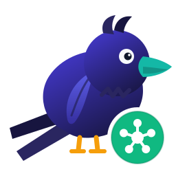

<p align="center">
  
</p>

<h1 align="center">Snodra Server</h1>

<p align="center">
  The router of the Snodra suite: commands and queries reach the live handler that owns them, in any language, without a broker in the path.
</p>

<p align="center">
  <a href="https://github.com/snodra/snodra-server/actions/workflows/ci.yml"></a>
  <a href="https://github.com/snodra/snodra-server/releases"></a>
  <a href="https://hub.docker.com/r/snodra/snodra-server"></a>
  
  
  <a href="https://snodra.damoreira.com/docs/"></a>
  <a href="LICENSE"></a>
</p>

---

## What it is

A single stateless gRPC process. Services register the command and query types they handle and open a
long-lived stream; a sender asks the server for a type and gets answered by whichever instance is live.
Nothing is stored and nothing is queued: Kafka carries the events, the services' own databases carry the
state, and the server only routes.

- **Commands and queries** routed by type, with consistent-hash or round-robin across instances.
- **Deadlines, retries and flow control** enforced at the router, not in every client.
- **Multi-server** without server-to-server traffic: every instance is independent.
- **Authentication** by static token, an OAuth2/OIDC JWT or mTLS, with per-service ACLs.
- **Dashboard**: live topology, types, processors, streams and the event browser, served from the same binary.
- **One protocol, four clients**: the Kotlin, Rust, Go and Python libraries speak `snodra.hub.v1`.

## Run it

```sh
docker run --rm -p 7000:7000 -p 7001:7001 snodra/snodra-server:0.6.0
```

gRPC is on `7000`, the dashboard on <http://localhost:7001>. With no configuration it accepts anonymous
clients, which is the quickest way to try it; production settings are in the
[server configuration](https://snodra.damoreira.com/docs/server/configuration/server/).

From the repository:

```sh
cargo run                 # gRPC :7000, dashboard :7001
cargo test                # unit and in-process integration tests
```

## Configuration

Everything is environment or flags, prefixed `SNODRA_SERVER_` — listen address, TLS, token file, JWT
issuer, ACL file, dashboard write access, OTLP. The full table is in the
[configuration reference](https://snodra.damoreira.com/docs/server/configuration/server/).

## Documentation

Quick start, authentication modes, deployment, the dashboard and the protocol: **<https://snodra.damoreira.com/docs/>**.

`proto/hub.proto` in this repository is the protocol's source of truth; the client libraries vendor it and
check it byte for byte.

## Contributing

Branches off `main`, conventional commits, a pull request with a green workflow. Design changes that
span repositories open on the server's tracker first.

## Releases

Versions are cut by CI from the commit types; nobody pushes tags. When the checks pass on a push to
`main`, the subjects since the last `v*` tag decide: any `feat` is the next minor, otherwise any `fix` or
`perf` the next patch, and anything else (`docs`, `test`, `chore`, `ci`, `refactor`, `build`, `style`)
releases nothing. CI then commits `release: X.Y.Z` (the version in `Cargo.toml`, `Cargo.lock` and this
README), tags `vX.Y.Z` and publishes the image, the GitHub release and the binaries. Pull before you
push: `main` then carries that commit.

- Below 1.0.0 any `type!:` subject and any line starting `BREAKING CHANGE:` in a message count as a
  minor, never a major: 1.0.0 is declared by hand.
- A revert (`Revert "feat: ..."`, `revert:`) is not a release reason: the reverted change stays in the
  last published version until the next `feat`, `fix` or `perf`.
- Only tags shaped `vN.N.N` count; the highest one reachable from `main` is the last release.
- `scripts/next-version.sh` holds the rule; `for t in scripts/*.test.sh; do sh "$t"; done` tests it.

If a release fails half way (the tag exists, some artifacts do not), use **Re-run failed jobs** on that
run: every step is safe to repeat. Or run the `release` workflow by hand with the existing tag. **Re-run
all jobs** on a run that released does nothing, because `main` has moved to its release commit.

## License

[Apache-2.0](LICENSE) © 2026 Guilherme D'Amoreira.
